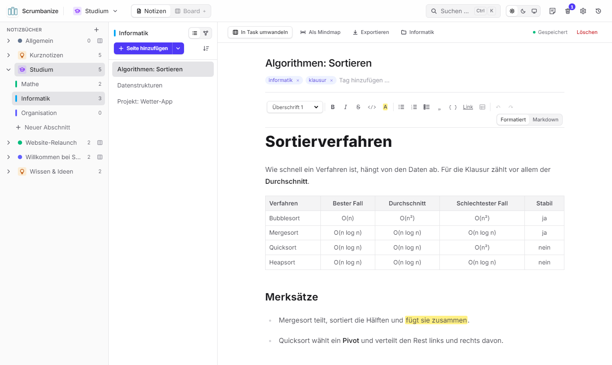
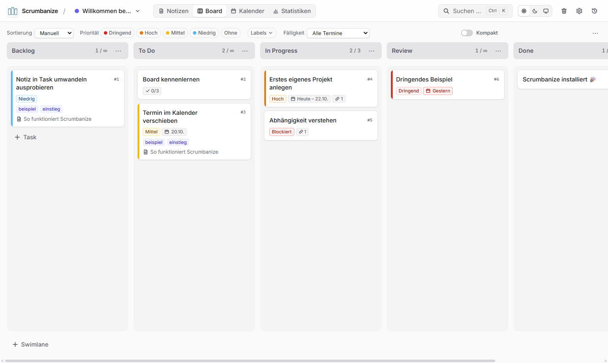
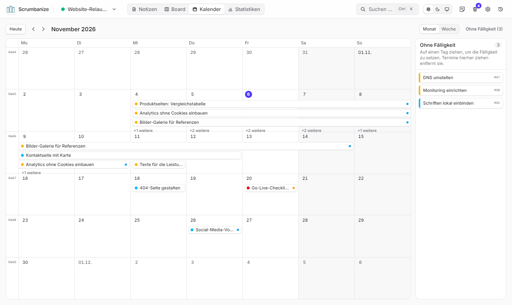
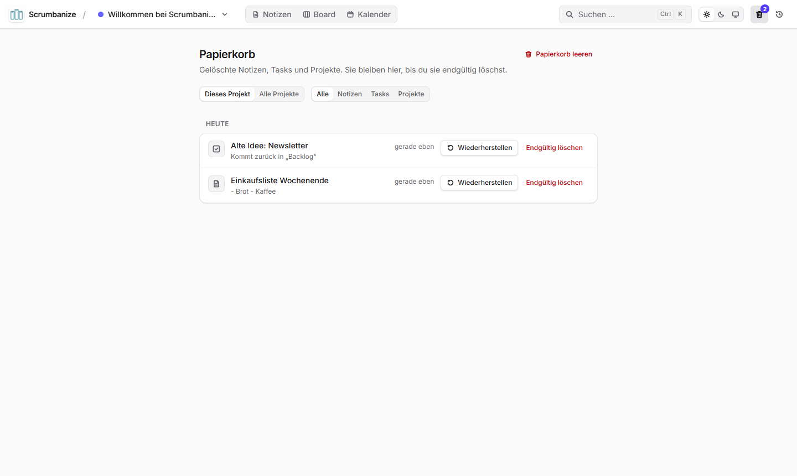

<p align="center">
  
</p>

<h1 align="center">Scrumbanize</h1>

<p align="center"><b>Notizen und Aufgaben an einem Ort – übersichtlich, privat und direkt auf deinem Computer.</b></p>

<p align="center">
  <a href="https://github.com/lukxstim/Scrumbanize/releases/latest">
    
  </a>
</p>

<p align="center">
  <a href="https://github.com/lukxstim/Scrumbanize/releases/latest"><b>Direkt-Download: neueste Version für Windows</b></a>
</p>

---

## Anleitung für die Installation

Du brauchst keine Vorkenntnisse – die Installation dauert etwa eine Minute.

> **Vorab:** Scrumbanize wird nur an eingeladene Personen verteilt. Du brauchst ein kostenloses GitHub-Konto und eine Einladung (kommt per E-Mail – einmal auf „Accept invitation“ klicken). Zum Herunterladen musst du bei GitHub **angemeldet** sein, sonst zeigt die Seite „404“.

**1. Herunterladen**
Klicke oben auf **„Jetzt herunterladen“**. Auf der Seite, die sich öffnet, siehst du unten den Bereich **„Assets“**. Klicke dort auf die Datei **`Scrumbanize-Setup-….exe`** – der Download startet.

**2. Ausführen**
Öffne die heruntergeladene Datei (meist im Ordner „Downloads“, oder unten bzw. oben rechts im Browser auf die Datei klicken).

Windows zeigt dann vielleicht ein **blaues Fenster „Der Computer wurde durch Windows geschützt“**. Das ist normal bei Programmen von kleinen Entwicklern und kein Virus-Fund. So geht es weiter:

1. Auf **„Weitere Informationen“** klicken.
2. Auf **„Trotzdem ausführen“** klicken.

Scrumbanize installiert sich jetzt von allein – ohne Fragen und ohne Administrator-Passwort.

**3. Starten und loslegen**
Scrumbanize öffnet sich nach der Installation automatisch. Später startest du es über das Symbol **„Scrumbanize“ auf dem Desktop** oder im **Startmenü**.

Beim ersten Start wartet ein **Beispielprojekt** mit einer kurzen Anleitung auf dich, und eine kleine Einführung zeigt dir die wichtigsten Knöpfe. Probier einfach alles aus – im Beispielprojekt kannst du nichts kaputt machen.

> **Ohne Installation?** Unter „Assets“ gibt es auch **`Scrumbanize-…-portable.exe`**. Die startet direkt, ohne Installation (z. B. vom USB-Stick), muss aber für neue Versionen von Hand ersetzt werden.

## Was kann Scrumbanize?

### Notizen
Schreibe Notizen mit Überschriften, Listen, **Checklisten** und farbigen Markierungen – so einfach wie in einem Textprogramm. Hänge Bilder, PDFs und Dokumente an. Aus jedem Satz wird mit einem Klick eine Aufgabe.



### Aufgaben-Board
Deine Aufgaben als Karten in Spalten wie „To Do“, „In Progress“ und „Done“. Ziehe Karten mit der Maus weiter, wenn du vorankommst. Prioritäten, Fälligkeiten und Checklisten siehst du direkt auf der Karte.



### Kalender
Alle Fälligkeiten im Monat oder in der Woche. Einen Termin verschiebst du, indem du ihn auf einen anderen Tag ziehst.



### Papierkorb
Aus Versehen gelöscht? Kein Problem: Gelöschtes landet zuerst im Papierkorb und lässt sich mit einem Klick wiederherstellen.



### Sichern, Importieren, Exportieren
Über das Zahnrad oben rechts (**Einstellungen**):
- **Backup mit einem Klick** – eine ZIP-Datei mit allen Projekten, Notizen, Tasks und Anhängen – und **Wiederherstellen** aus so einem Backup. Vor dem Wiederherstellen sichert Scrumbanize den jetzigen Stand automatisch.
- **Notizen importieren** aus Markdown-Dateien, ganzen Ordnern (z. B. Obsidian) oder ZIP-Exporten (z. B. Notion). Titel, Tags und Erstelldatum werden übernommen; Bilder noch nicht.
- **Exportieren**: alle Notizen als Markdown oder HTML (ZIP, mit Anhängen), das Board als CSV-Datei für Excel. Einzelne Notizen lassen sich auch direkt im Editor exportieren.

### Labels und Vorlagen
- **Farbige Labels** für Tasks (neue Projekte starten mit *Bug*, *Feature* und *Dringend*): auf den Karten, im Kalender und im Graph sichtbar, das Board lässt sich danach filtern. Verwalten über „Labels ▾“ in der Leiste über dem Board.
- **Vorlagen** für Notizen und Tasks, für ein Projekt oder für alle (dabei: *Meeting-Protokoll*, *Sprint-Planning*, *Bug-Report*). Platzhalter wie `{{datum}}`, `{{wochentag}}`, `{{uhrzeit}}`, `{{kw}}` und `{{projekt}}` werden beim Anlegen ausgefüllt; Taskvorlagen setzen auch Priorität, Labels, Spalte, Swimlane und einen Fälligkeitstermin („+7 Tage“). Auswählen beim Anlegen (Pfeil neben „Neue Notiz“, Vorlage unter „+ Task“, `Strg` + `K`), verwalten in den Einstellungen oder per „Als Vorlage speichern“.

### Und außerdem
- **Statistiken** zu erledigten Tasks, Durchlaufzeiten und WIP-Limits.
- **Graph und Mindmap**: Notizen und Tasks als Netzwerk ansehen, eine gegliederte Notiz als Mindmap (Export als SVG oder PNG).
- **Projekte**, um Privates, Arbeit oder Schule zu trennen – jedes mit eigener Farbe.
- **Suche über alles** mit `Strg` + `K`.
- **Heller und dunkler Modus.**
- **Verlauf**: Die Uhr oben rechts zeigt, was zuletzt passiert ist.

## Deine Daten

- Alles bleibt **auf deinem Computer** – es gibt kein Konto, keine Cloud und keine Werbung. Internet brauchst du nur zum Herunterladen.
- Gespeichert wird im Ordner `%APPDATA%\Scrumbanize` (in die Adresszeile des Explorers eintippen). **Zum Sichern** in den Einstellungen (Zahnrad oben rechts) auf „Backup herunterladen“ klicken und die Datei z. B. auf einen USB-Stick kopieren.
- Jede Person am Computer hat mit ihrem eigenen Windows-Konto auch ihre eigenen Notizen.

## Neue Version installieren

Alle **4 Wochen erinnert dich Scrumbanize** mit einem kleinen Hinweis unten rechts daran, nach einer neuen Version zu schauen. Ein Klick auf **„Nachsehen“** zeigt die neueste Version im Browser.

Gibt es dort eine neuere Version als deine (die Nummer steht im Hinweis), lade sie wie oben beschrieben herunter und führe die neue `Scrumbanize-Setup-….exe` aus. Sie ersetzt die alte Version – **deine Notizen und Aufgaben bleiben erhalten.**

## Hilfe

- **Die Einführung noch einmal sehen:** `Strg` + `K` drücken und „Einführung erneut starten“ wählen.
- **Etwas funktioniert nicht?** Melde dich bei der Person, die dir Scrumbanize empfohlen hat, oder lege auf GitHub unter [Issues](https://github.com/lukxstim/Scrumbanize/issues) eine Meldung an.

---

## Für Entwicklerinnen und Entwickler

Selbstgehostete Web-App, die Notizen und ein Scrumban-Board verbindet. Hintergrund und Ziele: [docs/vision.md](docs/vision.md), User Stories: [docs/stories](docs/stories).

**Stand:** US-01 bis US-13 sind umgesetzt:

- **Projekte:** Notizen und Board sind nach Projekten getrennt (z. B. „Privat“, „Studium“). Projekte werden im Header gewechselt, angelegt, umbenannt, eingefärbt und gelöscht (sie kommen nach einer Rückfrage in den Papierkorb; das letzte Projekt bleibt erhalten). Beim ersten Start gibt es das leere Projekt „Allgemein“ und das Beispielprojekt „Willkommen bei Scrumbanize“ (siehe Einstieg); das zuletzt geöffnete Projekt merkt sich der Browser.
- **Einstieg:** Eine neue Installation (leere Datenbank) legt einmalig das Beispielprojekt „Willkommen bei Scrumbanize“ an – mit einer Notiz „So funktioniert Scrumbanize“ (Checkliste, Hervorhebungen, Tastenkürzel) und sieben Tasks über alle Spalten (Prioritäten, Termine relativ zum ersten Start, Checkliste, Verknüpfung, aus der Notiz erstellt). Es öffnet sich beim ersten Besuch; gelöscht kommt es nicht wieder, und bestehende Installationen bekommen es beim Update nicht. Dazu zeigt eine kurze Einführung in 7 Schritten die wichtigsten Stellen im Header. Jeder Schritt hat „Überspringen“ und „Nicht erneut anzeigen“ (voreingestellt); die Wahl merkt sich der Browser. Ohne Haken erscheint die Einführung beim nächsten Start wieder. Neu starten: Befehlspalette → „Einführung erneut starten“.
- **Notizen** (`/p/:projectId/notes`): Titel, Inhalt und Tags, Auto-Save, Live-Suche und Tag-Filter.
- **Editor** für Notizen und Task-Beschreibungen: formatiert bearbeiten (WYSIWYG) mit Werkzeugleiste – Überschriften, fett, kursiv, durchgestrichen, Code, Hervorheben in 5 Farben, Listen, Checklisten, Zitat, Codeblock, Link, Rückgängig – und Markdown-Kürzeln beim Tippen (`## `, `- [ ] `, `**…**`). Gespeichert wird weiterhin Markdown (GFM); Hervorhebungen als `<mark data-color="…">`. Der Schalter „Formatiert / Markdown“ zeigt den Quelltext (merkt sich der Browser). Inhalte mit HTML oder Fußnoten öffnen nur als Markdown, damit nichts verloren geht. Beim Speichern über den Editor kann sich die Schreibweise vereinheitlichen (z. B. `*`-Listen zu `-`, `__fett__` zu `**fett**`), der Inhalt bleibt gleich.
- **Anhänge** an Notizen und Tasks: per Drag-and-Drop oder „auswählen“, bis zu 10 Dateien je Upload und 25 MB je Datei. Erlaubt sind Bilder (PNG, JPEG, GIF, WebP), PDF, Office (DOCX, XLSX, PPTX), OpenDocument (ODT, ODS, ODP), TXT, CSV, MD und ZIP – kein SVG. Bilder erscheinen als Vorschaubilder, andere Dateien als Liste; Bilder und PDFs öffnen in einer Vorschau (← → blättern), alles lässt sich herunterladen (mit Originalnamen) und nach Rückfrage endgültig entfernen. Anhänge folgen Notiz bzw. Task in den Papierkorb und werden beim endgültigen Löschen mit entfernt; bei der Umwandlung einer Notiz bleiben sie an der Notiz.
- **Task-Umwandlung:** ganze Notizen oder markierte Textpassagen über ein vorausgefülltes Formular (optional mit Priorität und Fälligkeit) in Tasks in der ersten Spalte desselben Projekts umwandeln; Notiz und Task sind gegenseitig verlinkt.
- **Scrumban-Board** (`/p/:projectId/board`, Task-Details unter `/p/:projectId/tasks/:id`):
  - Eigene Spalten und Swimlanes pro Projekt: anlegen, per Doppelklick umbenennen, über das ⋯-Menü sortieren (Spalten auch per Drag-and-Drop am Kopf) und löschen. Tasks einer gelöschten Spalte oder Swimlane werden in eine wählbare andere verschoben. Höchstens 20 Spalten und 20 Swimlanes; Namen sind pro Projekt eindeutig.
  - Neue Projekte starten mit Backlog, To Do, In Progress (WIP-Limit 3), Review, Done und der Swimlane „Standard“. Swimlane-Köpfe erscheinen ab zwei Swimlanes und lassen sich einklappen (merkt sich der Browser).
  - WIP-Limits für jede Spalte, über alle Swimlanes gezählt – nur als Warnung, nicht blockierend.
  - Tasks per Drag-and-Drop zwischen Spalten und Swimlanes verschieben (Maus, Touch, Tastatur: Leertaste aufnehmen, Pfeiltasten, Leertaste ablegen) oder per ◀ ▶. Neue Tasks landen in der ersten Spalte; jede Swimlane hat dort ein eigenes „+ Task“.
  - „Kompakt“ verkleinert Karten und Spalten; Spaltenköpfe bleiben beim Scrollen sichtbar.
  - **Verknüpfungen:** In den Task-Details lassen sich Tasks desselben Projekts verknüpfen – „Hängt zusammen mit“, „Blockiert“ und „Wird blockiert von“ (dieselbe Verknüpfung von der anderen Seite gesehen). Pro Task-Paar gibt es höchstens eine Verknüpfung; die Auswahl sucht nach Titel oder `#Nummer`. Verknüpfte Tasks erscheinen gruppiert und als Links in den Details; Karten zeigen die Anzahl (Tooltip mit der Liste) und „Blockiert“, solange ein blockierender Task nicht in der letzten Spalte steht. Verschieben bleibt trotzdem möglich.
  - Task-Karten zeigen den Fortschritt der Checkliste in der Beschreibung (z. B. „2/5“), die Anzahl der Anhänge, die Tags ihrer Notiz, die Priorität (farbiger Rand und Label) und die Fälligkeit („Heute“, „Morgen“, „17.10.“; überfällig rot).
  - **Prioritäten und Termine:** Jeder Task kann eine Priorität (Niedrig, Mittel, Hoch, Dringend), ein Fälligkeitsdatum und optional ein Startdatum haben – reine Kalendertage ohne Uhrzeit. Ein Start braucht eine Fälligkeit und liegt nicht danach. Gesetzt werden sie in den Task-Details (mit „Heute“, „Morgen“, „Nächste Woche“, „Entfernen“). Tasks in der letzten Spalte gelten als erledigt und sind nie überfällig.
  - **Sortieren und Filtern:** nach Priorität oder Fälligkeit sortieren, nach Priorität (auch „Ohne“) und Fälligkeit (überfällig, heute, diese Woche, mit/ohne Termin) filtern. Das ändert nur die Anzeige, nicht die gespeicherte Reihenfolge, und wird pro Projekt im Browser gemerkt. Solange sortiert wird, lässt sich die Reihenfolge innerhalb einer Zelle nicht per Drag-and-Drop ändern; WIP-Limits zählen immer alle Tasks.
- **Kalender** (`/p/:projectId/calendar`): Monats- (mit Kalenderwochen) und Wochenansicht der Tasks des Projekts nach Fälligkeit; Tasks mit Startdatum erscheinen als Balken über den Zeitraum. Termine per Drag-and-Drop verschieben (der ganze Zeitraum wandert mit; auch per Tastatur: Pfeiltasten = ±1 Tag/Woche), Tasks aus der Seitenleiste „Ohne Fälligkeit“ auf einen Tag ziehen oder einen Termin dorthin ziehen, um ihn zu entfernen. „+“ an einem Tag legt einen dort fälligen Task an, ein Klick öffnet die Task-Details. Wochen beginnen am Montag; erledigte Tasks sind ausgegraut.
- **Aktivität** (Uhr-Icon oben rechts oder Befehlspalette; öffnet sich als Seitenleiste über der aktuellen Seite, Adresse mit `?activity=1`, Escape oder Klick daneben schließt; die alte Adresse `/p/:projectId/activity` öffnet sie ebenfalls): protokolliert automatisch, was im Projekt passiert – Notizen, Tasks (inkl. Umwandlung aus Notizen, Spalten-/Swimlane-Wechsel, Verknüpfungen sowie Priorität und Terminen mit dem neuen Wert), Spalten, Swimlanes, WIP-Limits, Projekt-Änderungen und den Papierkorb (gelöscht, wiederhergestellt, endgültig gelöscht, geleert). Chronologisch nach Tagen gruppiert, filterbar nach Bereich, lädt beim Scrollen nach; Einträge verlinken auf die Notiz bzw. den Task, solange es sie gibt, und auf den Papierkorb, solange sie dort liegen. Wird ein Projekt endgültig gelöscht, verschwindet auch sein Protokoll. Bearbeitungen derselben Notiz oder desselben Tasks innerhalb von 10 Minuten (Auto-Save) werden zu einem Eintrag zusammengefasst; Umsortieren innerhalb einer Spalte wird nicht protokolliert.
- **Papierkorb** (`/p/:projectId/trash`, Icon mit Anzahl oben rechts neben der Uhr): Gelöschte Notizen, Tasks und Projekte landen zuerst im Papierkorb. Notizen und Tasks werden ohne Rückfrage gelöscht; die Meldung bietet „Rückgängig“. Im Papierkorb lassen sich Einträge wiederherstellen – an ihren alten Platz, Tasks in ihre Spalte und Swimlane, Notizen mit Tags und Task-Verknüpfungen – oder endgültig löschen; „Papierkorb leeren“ löscht alles auf einmal. Ansicht für das aktuelle Projekt oder „Alle Projekte“, filterbar nach Art, nach Tagen gruppiert. Ein Projekt im Papierkorb nimmt seine Notizen und Tasks mit und bringt sie beim Wiederherstellen zurück; ist sein Name inzwischen vergeben, heißt es danach z. B. „Studium (2)“. Nichts wird automatisch endgültig gelöscht. Notizen im Papierkorb erscheinen nicht als Quelle ihrer Tasks, Tasks im Papierkorb zählen nicht für WIP-Limits. Spalten und Swimlanes kommen nicht in den Papierkorb.
- **Befehlspalette** (`Strg+K` / `⌘K`, oder „Suchen …“ im Header): durchsucht Notizen und Tasks aller Projekte (das aktuelle zuerst), wechselt Projekte und Ansichten, legt Notizen, Tasks und Projekte an und schaltet Farbschema und Kompaktansicht um.
- **Design:** helles und dunkles Farbschema (Hell / Dunkel / System, Standard: System; merkt sich der Browser), Schrift Inter (lokal eingebunden, kein externes CDN), dezente Animationen (respektieren „Bewegung reduzieren“) und Toast-Meldungen. Optimiert für Bildschirme ab 1024 px Breite.

Die App ist für einen einzelnen Nutzer ohne Login gedacht – betreibe sie nur in einem vertrauenswürdigen Netz oder hinter einem Reverse-Proxy mit Authentifizierung.

Außerdem gibt es Scrumbanize als **Windows-Desktop-App** (US-08), die ohne installiertes Node.js läuft – siehe [Desktop-App](#desktop-app-windows).

## Desktop-App (Windows)

Die Desktop-App bündelt Frontend, Server und SQLite in einem Electron-Programm. Jede Person hat ihre eigenen, lokalen Daten; es gibt keine Synchronisation.

### Installieren und starten

Die Schritt-für-Schritt-Anleitung für Nutzerinnen und Nutzer steht oben unter [Anleitung für die Installation](#anleitung-für-die-installation). Zwei Varianten (Windows 10/11, 64 Bit):

- **`Scrumbanize-Setup-1.0.0.exe`** – Installer. Installiert ohne Administratorrechte für den aktuellen Benutzer (nach `%LOCALAPPDATA%\Programs\scrumbanize`) und legt Verknüpfungen auf dem Desktop und im Startmenü an. Deinstallation über „Apps & Features“.
- **`Scrumbanize-1.0.0-portable.exe`** – ohne Installation, z. B. vom USB-Stick. Startet etwas langsamer, weil sie sich bei jedem Start entpackt.

**Windows-SmartScreen:** Die Programme sind nicht signiert. Beim ersten Start zeigt Windows deshalb „Der Computer wurde durch Windows geschützt“. Auf **„Weitere Informationen“** klicken und dann **„Trotzdem ausführen“**.

### Daten

Notizen, Tasks und Einstellungen liegen in **`%APPDATA%\Scrumbanize\`** (z. B. `C:\Users\<Name>\AppData\Roaming\Scrumbanize\`):

| Datei | Inhalt |
|---|---|
| `scrumbanize.db` | Die Datenbank – dieselbe Art Datei wie bei Docker und in der Entwicklung |
| `uploads\` | Die Dateien der Anhänge (unter zufälligen Namen; die Originalnamen stehen in der Datenbank) |
| `window-state.json` | Fenstergröße und -position |
| `logs\main.log` | Protokoll für die Fehlersuche |
| `backups\` | Automatische Sicherungen vor jeder Wiederherstellung (die letzten 5) |

- **Backup:** in den Einstellungen „Backup herunterladen“ (geht auch während der Arbeit). Von Hand: Scrumbanize beenden und `scrumbanize.db` **und den Ordner `uploads`** kopieren.
- **Wiederherstellen:** in den Einstellungen ein Backup auswählen; Scrumbanize zeigt vorher, was es enthält, und sichert den jetzigen Stand.
- **Daten übernehmen** (z. B. von Docker oder aus der Entwicklung): Scrumbanize beenden und die vorhandene `scrumbanize.db` samt `uploads`-Ordner in diesen Ordner kopieren (bestehende Datei vorher sichern). Die Datenbank wird beim nächsten Start automatisch auf den aktuellen Stand gebracht.
- **Update:** neue Version einfach installieren bzw. die neue portable Datei verwenden – die Daten bleiben erhalten, auch beim Deinstallieren.

### Technik

- Der Server läuft im Electron-Hauptprozess und lauscht nur auf `127.0.0.1:41723` (ist der Port belegt, auf einem freien Port). Er nimmt nur Anfragen des App-Fensters an (Prüfung von `Host`- und `Origin`-Header), sodass Webseiten im Browser die lokale API nicht erreichen.
- Beim Beenden werden Server und Datenbank sauber geschlossen; es bleiben keine Prozesse im Hintergrund.
- Eine Instanz pro Benutzer: Ein zweiter Start holt das vorhandene Fenster nach vorn. Links zu anderen Seiten öffnen sich im Standardbrowser.

### Selbst bauen

Voraussetzungen: Windows, Node.js 24, Internetzugang beim ersten Build (`electron-builder` lädt Electron und NSIS herunter). Kein Python und keine Visual-Studio-Build-Tools nötig – `better-sqlite3` ist ein Node-API-Modul, dessen fertige Binärdatei auch in Electron läuft.

```sh
npm install
npm run desktop        # baut Client und Desktop-App und startet sie (Daten in "%APPDATA%\Scrumbanize (Dev)")
npm run desktop:dist   # erzeugt die .exe-Dateien in desktop/release/
```

### Release veröffentlichen

Die Download-Links oben und die Erinnerung in der Desktop-App (`RELEASES_URL` in `desktop/src/main.ts`) zeigen auf `https://github.com/lukxstim/Scrumbanize/releases/latest`. Das Repository ist privat: Wer die App bekommen soll, wird unter **Settings → Collaborators** eingeladen und lädt angemeldet herunter. Die App prüft selbst nicht auf Updates (ohne Zugangsdaten sieht sie die privaten Releases nicht); sie erinnert alle 4 Wochen an einen Blick auf die Release-Seite – die Versionsnummer im Hinweis kommt aus `desktop/package.json`.

1. Version in `desktop/package.json` erhöhen (z. B. `1.0.0` → `1.1.0`); sie steht im Namen der `.exe`-Dateien.
2. `npm run desktop:dist` – erzeugt in `desktop/release/` die Dateien `Scrumbanize-Setup-<Version>.exe` und `Scrumbanize-<Version>-portable.exe`.
3. Änderungen committen und pushen.
4. Auf GitHub: **Releases → „Draft a new release“** → Tag `v<Version>` anlegen (auf `main`), Titel z. B. „Scrumbanize 1.1.0“, kurze Beschreibung der Neuerungen auf Deutsch.
5. Beide `.exe`-Dateien in das Feld „Attach binaries“ ziehen und **„Publish release“** klicken. Der Link „neueste Version“ zeigt danach automatisch auf dieses Release.

Im Desktop-Fenster öffnet `F12` die Entwicklertools, nur beim ungepackten Start (`npm run desktop`). Die Umgebungsvariable `SCRUMBANIZE_USER_DATA` legt für Tests einen anderen Datenordner fest.

## Betrieb mit Docker

```sh
docker compose up -d --build
```

Die App läuft danach auf <http://localhost:3000>. Ein anderer Port lässt sich mit `SCRUMBANIZE_PORT=8080 docker compose up -d` setzen.

Die SQLite-Datenbank und die Anhänge liegen im Volume `scrumbanize-data` (im Container unter `/data/scrumbanize.db` und `/data/uploads/`) und bleibt bei Neustarts und Updates erhalten. Backup und Wiederherstellung gehen in der App über **Einstellungen** (Zahnrad oben rechts); Sicherungen vor einer Wiederherstellung landen unter `/data/backups/`. Ohne Browser, z. B. für ein nächtliches Backup:

```sh
curl -o scrumbanize-backup.zip http://localhost:3000/api/backup
```

Oder direkt im Container, während er läuft:

```sh
docker compose exec scrumbanize node -e "require('better-sqlite3')('/data/scrumbanize.db').backup('/data/backup.db')"
docker compose cp scrumbanize:/data/backup.db ./backup.db
docker compose cp scrumbanize:/data/uploads ./uploads   # die Dateien der Anhänge
```

## Entwicklung

Voraussetzung: Node.js 24.

```sh
npm install
npm run dev        # API auf :3000, Vite-Dev-Server auf http://localhost:5173
npm test           # Tests für Server und Client
npm run typecheck
npm run build      # Client nach client/dist, Server nach server/dist
npm start          # Produktionsserver, liefert auch den gebauten Client aus
```

Lokal liegen die Datenbank unter `data/scrumbanize.db` und die Anhänge unter `data/uploads/` (per `.gitignore` ausgeschlossen).

### Konfiguration (Umgebungsvariablen)

| Variable      | Standard                 | Bedeutung                               |
|---------------|--------------------------|-----------------------------------------|
| `PORT`        | `3000`                   | Port des Servers                        |
| `HOST`        | alle Netzwerkschnittstellen | Adresse, an die der Server bindet (z. B. `127.0.0.1`) |
| `DATA_DIR`    | `<repo>/data`, Docker: `/data` | Verzeichnis der SQLite-Datenbank und der Anhänge (`uploads/`) |
| `CLIENT_DIST` | `<repo>/client/dist`     | Gebauter Client, der mit ausgeliefert wird |

## Projektstruktur

npm-Workspaces mit drei Paketen:

- `server/` – Express-REST-API mit SQLite (`better-sqlite3`). Start `src/start.ts` (`startServer()`, genutzt von `src/index.ts` und der Desktop-App), App-Aufbau `src/app.ts`, Schema und Migrationen `src/database.ts`.
- `desktop/` – Electron-Hauptprozess (`src/main.ts`), mit esbuild zu `dist/main.cjs` gebündelt; Paketierung mit `electron-builder.yml`.
- `client/` – React-SPA mit TypeScript, Vite und Tailwind CSS. Farben kommen aus semantischen Design-Tokens (`bg-surface`, `text-fg-muted`, `border-line`, `bg-accent` …), definiert in `src/index.css` für hell und dunkel; wiederverwendbare Bausteine liegen in `src/components/ui/`.

## REST-API

Listen und Neuanlagen gehören zu einem Projekt (`/api/projects/:projectId/…`). Einzelne Notizen und Tasks werden über ihre projektübergreifend eindeutige ID angesprochen.

| Methode | Pfad              | Beschreibung |
|---------|-------------------|--------------|
| GET     | `/api/health`     | Health-Check |
| GET     | `/api/meta`       | Angaben zur Installation: `{ "sampleProjectId", "desktop", "restoredAt" }` – das Beispielprojekt des ersten Starts (`null`, wenn es (nicht mehr) existiert oder im Papierkorb liegt), Version der Desktop-App (sonst `null`) und Zeitpunkt der letzten Wiederherstellung eines Backups (sonst `null`) |
| GET     | `/api/projects`   | Alle Projekte, alphabetisch, mit `noteCount` und `taskCount` |
| POST    | `/api/projects`   | Projekt anlegen: `{ "name", "color" }` – Farben: `slate`, `red`, `amber`, `emerald`, `sky`, `indigo`, `violet`, `pink`. Namen sind eindeutig (ohne Groß-/Kleinschreibung), sonst 409 |
| PATCH   | `/api/projects/:id` | Name und/oder Farbe ändern |
| DELETE  | `/api/projects/:id` | Projekt mit allen Notizen und Tasks in den Papierkorb verschieben; das letzte Projekt nicht (409) |
| GET     | `/api/projects/:id/notes` | Notizen des Projekts, zuletzt geänderte zuerst. Optional `?q=` (Volltext in Titel, Inhalt, Tags) und `?tag=` (mehrfach möglich, alle müssen passen) |
| POST    | `/api/projects/:id/notes` | Notiz anlegen: `{ "title": "", "content": "", "tags": [] }` |
| GET     | `/api/projects/:id/tags` | Tags der Notizen des Projekts mit Anzahl |
| POST    | `/api/projects/:id/tasks` | Task am Ende der ersten Spalte anlegen: `{ "title", "description", "sourceNoteId"?, "laneId"?, "priority"?, "startDate"?, "dueDate"? }` – Notiz und Swimlane müssen zum Projekt gehören; ohne `laneId` die erste Swimlane |
| GET     | `/api/projects/:id/board` | Board des Projekts: `{ "columns": [{ id, name, position, wipLimit }], "lanes": [{ id, name, position }], "tasks" }` |
| POST    | `/api/projects/:id/columns` | Spalte anhängen: `{ "name", "wipLimit"? }` – Namen pro Projekt eindeutig (ohne Groß-/Kleinschreibung), max. 40 Zeichen; höchstens 20 Spalten (sonst 409) |
| POST    | `/api/projects/:id/lanes` | Swimlane anhängen: `{ "name" }` – gleiche Regeln wie bei Spalten |
| PATCH   | `/api/columns/:id` | Name und/oder WIP-Limit ändern: `{ "name"?, "wipLimit"?: number \| null }` |
| POST    | `/api/columns/:id/move` | Spalte umsortieren: `{ "index" }` – Position unter den übrigen Spalten |
| DELETE  | `/api/columns/:id?moveTasksTo=:columnId` | Spalte löschen; hat sie Tasks, ist `moveTasksTo` Pflicht (sonst 409). Die letzte Spalte bleibt erhalten (409) |
| PATCH, POST, DELETE | `/api/lanes/:id`, `/api/lanes/:id/move` | Swimlane umbenennen (`{ "name" }`), umsortieren und löschen – wie bei Spalten |
| GET     | `/api/notes/:id`  | Eine Notiz |
| PUT     | `/api/notes/:id`  | Notiz vollständig ersetzen: `{ "title", "content", "tags" }` |
| DELETE  | `/api/notes/:id`  | Notiz in den Papierkorb verschieben |
| GET     | `/api/tasks/:id`  | Ein Task inkl. Quell-Notiz (`sourceNote`) |
| PATCH   | `/api/tasks/:id`  | Felder ändern: `{ "title"?, "description"?, "priority"?, "startDate"?, "dueDate"? }` – fehlende Felder bleiben, `null` entfernt Priorität bzw. Datum. Verletzt das Ergebnis die Datumsregeln, gibt es 400 `invalid_schedule` |
| POST    | `/api/tasks/:id/move` | Task verschieben: `{ "columnId", "laneId", "index" }` – Spalte und Swimlane müssen zum Projekt des Tasks gehören; `index` ist die Zielposition unter den übrigen Tasks der Zelle |
| POST    | `/api/tasks/:id/links` | Verknüpfen: `{ "targetId", "kind" }` mit `kind` `relates`, `blocks` oder `blocked_by` (aus Sicht von `:id`). Antwort: beide Tasks `{ task, target }`. 400 bei Verknüpfung mit sich selbst oder einem anderen Projekt, 409, wenn das Paar schon verknüpft ist |
| DELETE  | `/api/tasks/:id/links/:linkId` | Verknüpfung entfernen (von beiden Seiten aus möglich); Antwort: beide Tasks |
| POST    | `/api/notes/:id/attachments`, `/api/tasks/:id/attachments` | Dateien anhängen: `multipart/form-data` mit dem Feld `files` (bis zu 10, je max. 25 MB). Antwort 201: `[{ id, fileName, mimeType, size, createdAt }]`. 413 bei zu großen Dateien, 415 bei nicht erlaubtem Typ, 404, wenn Notiz bzw. Task fehlt oder im Papierkorb liegt |
| GET     | `/api/attachments/:id/file?download=1` | Die Datei mit Originalnamen: Bilder und PDFs zur Anzeige im Browser, alles andere (und mit `download`) als Download. Immer mit `nosniff`, außer bei PDFs auch mit `Content-Security-Policy: sandbox` |
| DELETE  | `/api/attachments/:id` | Anhang samt Datei endgültig löschen |
| DELETE  | `/api/tasks/:id`  | Task in den Papierkorb verschieben |
| GET     | `/api/backup` | Backup als ZIP: `manifest.json` (`{ app, format, schemaVersion, createdAt, counts }`), `scrumbanize.db` (konsistenter Schnappschuss per `VACUUM INTO`) und `uploads/` |
| POST    | `/api/backup/restore` | Schritt 1 der Wiederherstellung: `multipart/form-data` mit dem Feld `file` (max. 2 GB). Entpackt und prüft (nur erwartete Dateien, Integrität, Schema-Version), ersetzt noch nichts. Antwort: `{ token, manifest, counts, missingFiles }`. 400 `invalid_backup` bzw. `backup_too_new` |
| POST    | `/api/backup/restore/:token` | Schritt 2: sichert den jetzigen Stand nach `backups/` (die letzten 5 bleiben) und ersetzt dann alle Daten in einer Transaktion. Antwort: `{ counts, safetyCopy }`. Andere Fenster erkennen das an `restoredAt` in `/api/meta` |
| DELETE  | `/api/backup/restore/:token` | Geprüftes Backup verwerfen |
| GET     | `/api/notes/:id/export?format=md\|html` | Eine Notiz als Markdown (mit Front Matter) oder druckbares HTML |
| GET     | `/api/projects/:projectId/export/notes?format=md\|html` | Alle Notizen des Projekts als ZIP, Anhänge unter `Anhänge/<Notiz>/` |
| GET     | `/api/projects/:projectId/export/board.csv` | Alle Tasks als CSV für Excel (UTF-8 mit BOM, Semikolon, Datum `TT.MM.JJJJ`) |
| POST    | `/api/projects/:projectId/import/notes` | `{ notes: [{ title, content, tags, createdAt? }] }` (bis zu 50 je Anfrage). Vorhandene Titel bekommen eine Nummer („Titel (2)“). Ein Eintrag im Verlauf je Import. Antwort 201: `{ created: [{ id, title }] }` |
| GET/POST | `/api/projects/:projectId/labels` | Labels des Projekts (`[{ id, name, color }]`, Farben wie bei Projekten) bzw. neues Label `{ name, color }`. 409 bei doppeltem Namen oder mehr als 30 Labels |
| PATCH/DELETE | `/api/labels/:id` | Label umbenennen/umfärben bzw. löschen (wird von allen Tasks entfernt). `POST /api/labels/:id/move` mit `{ index }` sortiert, `GET /api/labels/:id/usage` zählt die Tasks |
| GET/POST | `/api/projects/:projectId/templates?kind=note\|task` | Vorlagen des Projekts und für alle Projekte bzw. neue Vorlage `{ kind, scope: "project"\|"global", name, title, content, defaults }`; `defaults` für Tasks: `{ priority, labels, column, lane, dueInDays }` (Labels, Spalte, Swimlane als Namen) |
| PATCH/DELETE | `/api/projects/:projectId/templates/:id` | Vorlage ändern bzw. löschen; protokolliert im Projekt der Anfrage |
| GET     | `/api/trash?project=` | Papierkorb, zuletzt gelöschte zuerst: `[{ type, id, projectId, projectName, projectColor, title, deletedAt, snippet?, columnName?, noteCount?, taskCount? }]` mit `type` `note`, `task` oder `project`. `project` beschränkt Notizen und Tasks auf ein Projekt; gelöschte Projekte sind immer dabei, Notizen und Tasks gelöschter Projekte nie einzeln |
| POST    | `/api/trash/:type/:id/restore` | Wiederherstellen: `{ type, item, renamedFrom? }` – `item` ist die Notiz, der Task bzw. das Projekt; `renamedFrom`, wenn der Projektname inzwischen vergeben war |
| DELETE  | `/api/trash/:type/:id` | Endgültig löschen (Projekte mit allen Inhalten und ihrem Aktivitätsprotokoll) |
| DELETE  | `/api/trash?project=` | Papierkorb leeren – mit `project` nur dessen Notizen und Tasks, sonst alles inklusive gelöschter Projekte: `{ notes, tasks, projects }` |
| GET     | `/api/projects/:id/activities?type=&before=&limit=` | Aktivitätsprotokoll, neueste zuerst: `{ "items": [{ id, entityType, entityId, actionType, description, metadata, createdAt, exists }], "nextCursor" }`. `type`: `note`, `task`, `board` oder `project`; `before`: `nextCursor` der vorigen Seite; `limit` 1–100 (Standard 30). `exists` sagt, ob die Notiz bzw. der Task noch existiert |
| GET     | `/api/search?q=&project=&limit=` | Suche über alle Projekte für die Befehlspalette: `{ "notes": [{ id, projectId, title, snippet }], "tasks": [{ id, projectId, title, columnName }] }` – Treffer des Projekts `project` zuerst, `limit` 1–50 (Standard 20) |

Notizen und Tasks enthalten ihre Anhänge (`attachments`). Tasks enthalten ihre Verknüpfungen (`links: [{ id, kind, task: { id, title, columnId, columnName, done } }]`, `done` = letzte Spalte). `priority` ist `low`, `medium`, `high`, `urgent` oder `null`; `startDate` und `dueDate` sind Kalendertage `YYYY-MM-DD` oder `null`, ein `startDate` braucht ein `dueDate` am selben Tag oder später. Tags werden normalisiert (Kleinschreibung, ohne Kommas, max. 32 Zeichen). Tags, die keine Notiz mehr verwendet, werden automatisch entfernt. Notizen enthalten ihre verknüpften Tasks (`tasks`). Tasks sind Kopien: spätere Änderungen an der Notiz werden nicht übernommen, und beim Löschen einer Notiz bleiben ihre Tasks erhalten. Was im Papierkorb liegt, liefern die übrigen Endpunkte nicht mehr (404) – auch nicht in Suche, Listen und Zählern. Fehler haben die Form `{ "error": { "code", "message" } }`.
