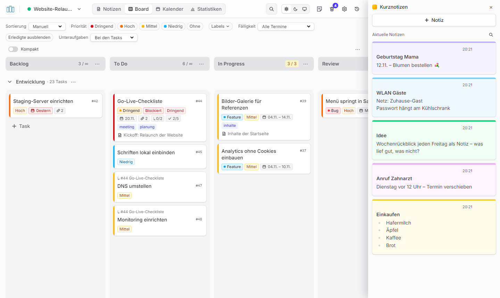
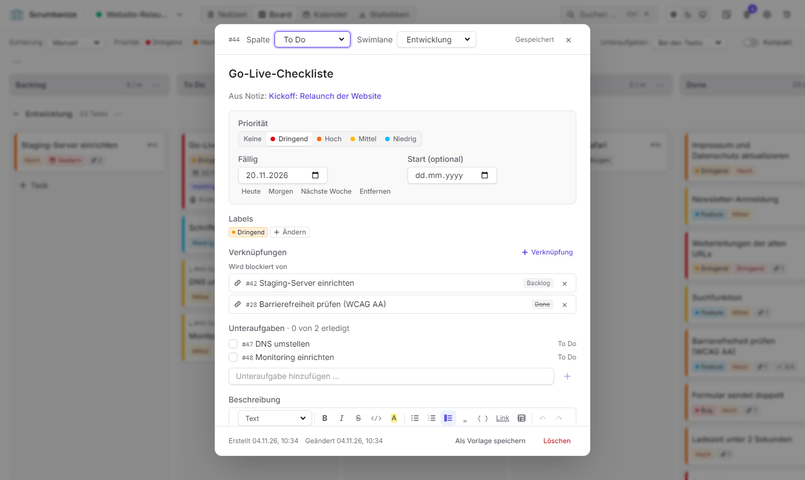
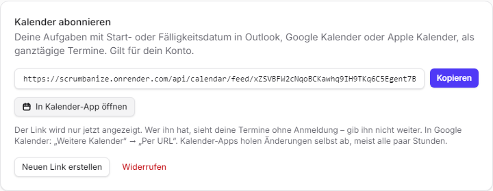
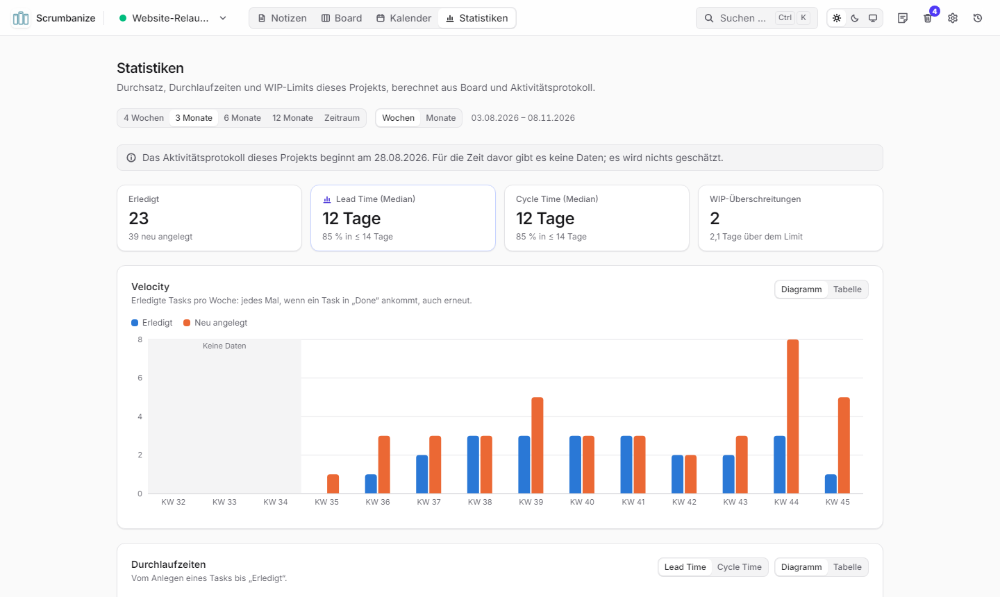
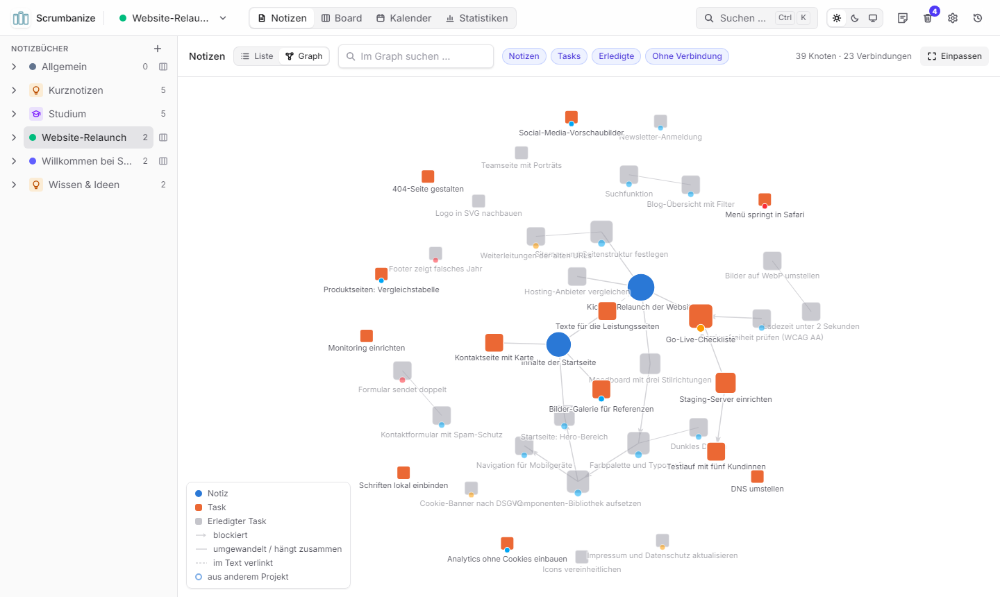
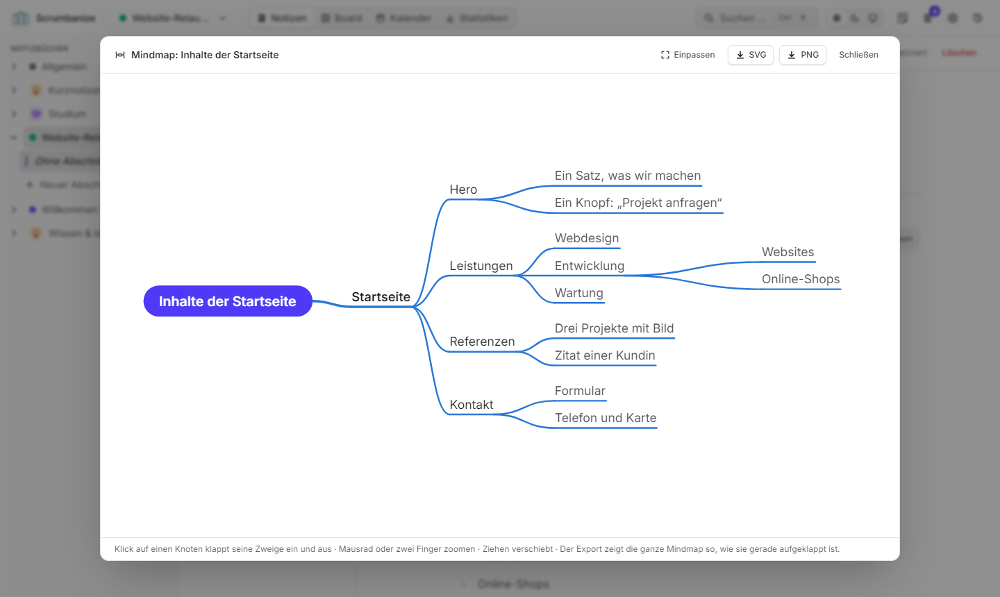
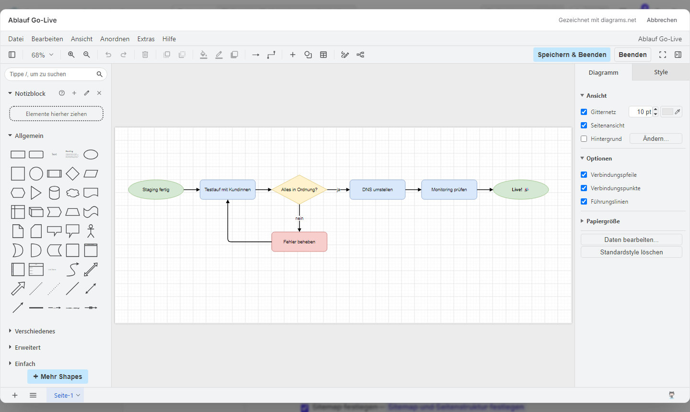
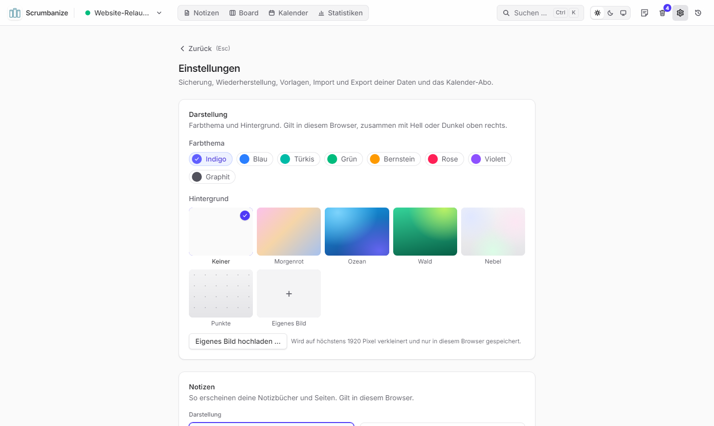
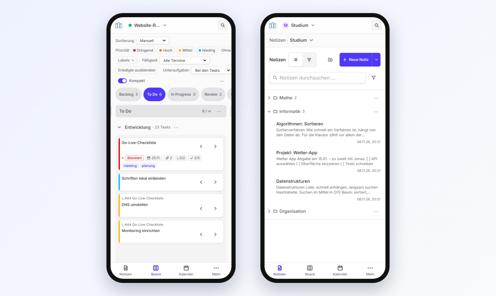
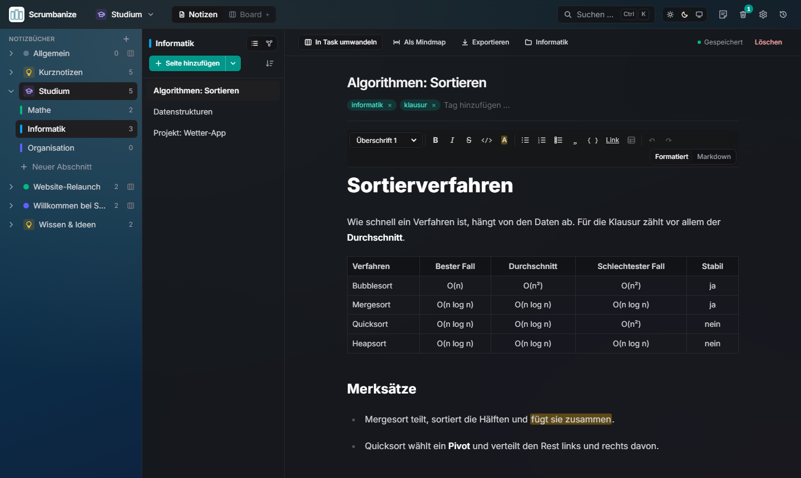

<p align="center">
  
</p>

<h1 align="center">Scrumbanize</h1>

<p align="center"><b>Notizen und Aufgaben an einem Ort – als App für Windows und Mac oder direkt im Browser, auch auf dem Handy.</b></p>

<p align="center">
  <a href="https://scrumbanize.onrender.com">
    
  </a>
</p>
<p align="center">
  <a href="https://github.com/lukxstim/Scrumbanize/releases/latest">
    
  </a>
  <a href="https://github.com/lukxstim/Scrumbanize/releases/latest">
    
  </a>
</p>

<p align="center">
  <a href="https://github.com/lukxstim/Scrumbanize/releases/latest"><b>Direkt-Download: neueste Version für Windows und Mac</b></a>
  ·
  <a href="https://scrumbanize.onrender.com"><b>Web-Version: scrumbanize.onrender.com</b></a>
  ·
  <a href="RELEASE_NOTES.md"><b>Was ist neu in 1.2.0?</b></a>
</p>


---

## Anleitung für die Installation

Du brauchst keine Vorkenntnisse. Es gibt drei Wege, die du auch kombinieren kannst:

| | Was du bekommst | Anleitung |
|---|---|---|
| **Im Browser** | Nichts installieren, überall anmelden – am Computer, Tablet und Handy. Gemeinsam mit anderen arbeiten. | [Web-Version](#web-version-im-browser) |
| **Windows** | Eine App mit Erinnerungen, Symbol neben der Uhr und Kurznotizen am Bildschirmrand. | [Windows](#windows) |
| **Mac** | Dieselbe App für Macs mit Apple-Chip und Intel. | [Mac](#mac) |

Die Desktop-App speichert zunächst alles auf deinem Computer. Verbindest du sie mit der Web-Version, sind [App und Browser auf demselben Stand](#desktop-app-und-web-version-verbinden).

> **Vorab:** Scrumbanize wird nur an eingeladene Personen verteilt. Für die Web-Version bekommst du einen Einladungs-Link von der Person, die dir Scrumbanize empfohlen hat. Für die Desktop-App brauchst du ein kostenloses GitHub-Konto und eine Einladung zum Projekt (kommt per E-Mail – einmal auf „Accept invitation“ klicken). Zum Herunterladen musst du bei GitHub **angemeldet** sein, sonst zeigt die Seite „404“.

### Web-Version im Browser

**1. Einladung annehmen**
Öffne den Einladungs-Link, den du bekommen hast. Gib deinen Namen und ein Passwort ein – fertig, du bist angemeldet.

**2. Später wieder anmelden**
Öffne **[scrumbanize.onrender.com](https://scrumbanize.onrender.com)** und melde dich mit E-Mail und Passwort an. Passwort vergessen? Die Person, die dich eingeladen hat, schickt dir einen Link zum Zurücksetzen.

**3. Als App aufs Handy oder den Computer**
- **iPhone/iPad (Safari):** Teilen-Symbol → **„Zum Home-Bildschirm“**.
- **Android (Chrome):** Menü ⋮ → **„App installieren“** bzw. „Zum Startbildschirm hinzufügen“.
- **Computer (Chrome, Edge):** das Installieren-Symbol rechts in der Adressleiste.

Scrumbanize startet dann wie eine App, ohne Browser-Leisten. Neue Versionen kommen von selbst; ein kleiner Hinweis bietet „Neu laden“ an.

> **Gut zu wissen:** Deine Daten liegen auf dem Server und werden jede Nacht gesichert. Während eines Updates ist die Web-Version ein bis zwei Minuten nicht erreichbar.

Weiter geht es mit der Anleitung für [Windows](#windows) oder für den [Mac](#mac) – oder direkt zu [Was kann Scrumbanize?](#was-kann-scrumbanize)

### Windows

**1. Herunterladen**
Klicke oben auf **„Jetzt herunterladen“**. Auf der Seite, die sich öffnet, siehst du unten den Bereich **„Assets“**. Klicke dort auf die Datei **`Scrumbanize-Setup-….exe`** – der Download startet.

**2. Ausführen**
Öffne die heruntergeladene Datei (meist im Ordner „Downloads“, oder unten bzw. oben rechts im Browser auf die Datei klicken).

Windows zeigt dann vielleicht ein **blaues Fenster „Der Computer wurde durch Windows geschützt“**. Das ist normal bei Programmen von kleinen Entwicklern und kein Virus-Fund. So geht es weiter:

1. Auf **„Weitere Informationen“** klicken.
2. Auf **„Trotzdem ausführen“** klicken.

Scrumbanize installiert sich jetzt von allein – ohne Fragen und ohne Administrator-Passwort.

**3. Starten und loslegen**
Scrumbanize öffnet sich nach der Installation automatisch. Später startest du es über das Symbol **„Scrumbanize“ auf dem Desktop** oder im **Startmenü**.

Beim ersten Start wartet ein **Beispielprojekt** mit einer kurzen Anleitung auf dich, und eine kleine Einführung zeigt dir die wichtigsten Knöpfe. Probier einfach alles aus – im Beispielprojekt kannst du nichts kaputt machen.

> **Ohne Installation?** Unter „Assets“ gibt es auch **`Scrumbanize-…-portable.exe`**. Die startet direkt, ohne Installation (z. B. vom USB-Stick), muss aber für neue Versionen von Hand ersetzt werden.

### Mac

Scrumbanize läuft auf jedem Mac mit **macOS 12 (Monterey) oder neuer** – egal ob mit Apple-Chip (M1, M2 …) oder Intel-Prozessor. Es gibt nur eine Datei für alle.

**1. Herunterladen**
Klicke oben auf **„Jetzt herunterladen“** und unter **„Assets“** auf **`Scrumbanize-…-universal.dmg`**.

**2. Installieren**
Öffne die heruntergeladene Datei (im Ordner „Downloads“). Es erscheint ein Fenster mit Scrumbanize links und dem Ordner „Programme“ rechts: **Ziehe Scrumbanize auf den Ordner „Programme“.** Danach kannst du das Fenster schließen und im Finder links neben „Scrumbanize“ auf das Auswerfen-Symbol ⏏ klicken.

**3. Beim ersten Start einmal erlauben**
Scrumbanize ist kostenlos und deshalb nicht bei Apple registriert. Der Mac fragt darum beim ersten Start nach – das ist normal und nur einmal nötig.

*macOS 15 (Sequoia) und neuer:*

1. Scrumbanize im Ordner „Programme“ doppelklicken. Es erscheint **„Scrumbanize“ kann nicht geöffnet werden** – auf **„Fertig“** klicken.
2. Das Apple-Menü  → **Systemeinstellungen** → **Datenschutz & Sicherheit** öffnen und ganz nach unten scrollen.
3. Bei „Scrumbanize wurde blockiert …“ auf **„Dennoch öffnen“** klicken, mit deinem Mac-Passwort bestätigen und noch einmal **„Dennoch öffnen“** wählen.

*macOS 14 (Sonoma) und älter:* Scrumbanize im Ordner „Programme“ mit **gedrückter `ctrl`-Taste anklicken** (oder Rechtsklick), **„Öffnen“** wählen und im Hinweis noch einmal **„Öffnen“** klicken.

Danach startet Scrumbanize ganz normal, z. B. über das Launchpad oder Spotlight (`⌘` + `Leertaste`, „Scrumbanize“ tippen).

**4. Gut zu wissen auf dem Mac**
- Schließt du das Fenster, läuft Scrumbanize weiter (Symbol im Dock und oben in der Menüleiste) und kann dich an fällige Aufgaben erinnern. **Ganz beenden** mit `⌘` + `Q`.
- Bei der ersten Erinnerung fragt der Mac, ob Scrumbanize **Mitteilungen** senden darf – auf **„Erlauben“** klicken. Ändern lässt sich das später unter Systemeinstellungen → Mitteilungen → Scrumbanize.
- Tastenkürzel heißen auf dem Mac `⌘` statt `Strg`, z. B. `⌘` + `K` für die Suche.

### Desktop-App und Web-Version verbinden

So haben die Desktop-App und die Web-Version **denselben Stand** – was du am Computer schreibst, siehst du sofort im Browser und auf dem Handy und umgekehrt.

1. **Nur wenn du Notizen aus der Desktop-App mitnehmen willst:** In der Desktop-App Zahnrad oben rechts → **„Backup herunterladen“**. Dann in der Web-Version (als Administratorin bzw. Administrator) Zahnrad → **„Wiederherstellen“** und die ZIP-Datei auswählen. Dein Konto bleibt dabei erhalten.
2. In der Desktop-App: Zahnrad → Abschnitt **Desktop-App** → ganz unten **Speicherort**.
3. `scrumbanize.onrender.com` eintragen und **„Verbinden“** klicken.
4. Mit deinem Konto der Web-Version anmelden – das ist nur einmal nötig.

Unter „Speicherort“ steht danach **„Verbunden mit https://scrumbanize.onrender.com“**. Erinnerungen, Kurznotizen und das Symbol neben der Uhr funktionieren wie gewohnt. Zurück zu den Daten auf dem Computer geht es mit **„Wieder auf diesem Computer speichern“** (oder im Menü des Symbols neben der Uhr). Ohne Internet ist der Server nicht erreichbar; dann fragt die App beim Start, ob sie vorerst mit den Daten auf dem Computer arbeiten soll.

## Was kann Scrumbanize?

> **Neu in Version 1.2.0:** Scrumbanize gibt es jetzt **im Browser** – mit Konten, Teilen und **Live-Zusammenarbeit**, auch auf dem **Handy**. Die Desktop-App kann mit der Web-Version **denselben Stand** haben. Notizen sind in **Notizbüchern wie bei OneNote** organisiert, dazu kommen **Tabellen**, **Kurznotizen**, **Diagramme**, **Unteraufgaben**, ein **Kalender-Abo** für Outlook, Google und Apple und **Farbthemen**. Alle Neuerungen stehen in den [Release-Notizen](RELEASE_NOTES.md).

### Notizen
Schreibe Notizen mit Überschriften, Listen, **Checklisten**, **Tabellen** und farbigen Markierungen – so einfach wie in einem Textprogramm. Hänge Bilder, PDFs und Dokumente an oder zeichne ein **Diagramm**. Aus jedem Satz wird mit einem Klick eine Aufgabe.

### Notizbücher, Boards und Ordner
Alles liegt in **Notizbüchern** – fürs Studium, ein Projekt, Rezepte oder Ideen –, jedes mit Farbe und, wenn du willst, einem Symbol. Ein Notizbuch kann ein **Board** haben (mit Kalender und Statistiken für seine Aufgaben) oder nur Notizen; du schaltest es unter „Bearbeiten …“ mit „Board verwenden“ ein und aus. Schaltest du ein Board aus, werden seine Aufgaben nur ausgeblendet, nicht gelöscht – vorher sagt Scrumbanize, wie viele es sind, und schaltest du es wieder ein, ist alles wieder da. Das letzte Notizbuch mit Board bleibt immer erhalten, damit Aufgaben einen Platz haben. Die Seitenleiste links zeigt alle Notizbücher, über „⋯“ bearbeitest oder teilst du sie. Zum Start gibt es das Beispiel-Notizbuch „Wissen & Ideen“ mit einer kurzen Anleitung und einem Rezept im Ordner „Rezepte“. Notizen ordnest du in **Ordnern** (bis zu fünf Ebenen tief): per Drag-and-Drop oder über „Verschieben nach …“. Wird ein Ordner gelöscht, rückt sein Inhalt eine Ebene nach oben – keine Notiz geht verloren.

**Wie OneNote:** Links stehen die Notizbücher; aufgeklappt zeigen sie ihre **Abschnitte** (die Ordner, mit Farbbalken), mehrere Notizbücher können gleichzeitig offen sein. Daneben stehen die **Seiten** des gewählten Abschnitts, rechts die Seite. Seiten und Abschnitte ziehst du mit der Maus in eine neue Reihenfolge; eine Seite, die du auf einen Abschnitt oder ein Notizbuch ziehst, wandert dorthin – auch in ein anderes Notizbuch. In den Einstellungen („Notizen“) wählst du stattdessen die Listen-Ansicht mit Textanfang und Datum und schaltest **Tags** ein (an den Seiten und als Filter). Die Suche mit `Strg` + `K` findet alles.

**Kurznotizen:** Für schnelle Kleinigkeiten gibt es eine Leiste wie die Windows Sticky Notes – Button oben rechts im Header (oder `Strg` + `K` → „Kurznotizen öffnen“, in der Desktop-App auch im Tray-Menü). „+ Notiz“, tippen, fertig: Jede Kurznotiz ist eine farbige Karte, die erste Zeile ihr Titel, „- “ macht eine Liste; ein Klick auf eine Karte bearbeitet sie, alles speichert sich selbst. Gespeichert werden sie im Notizbuch „Kurznotizen“, das beim ersten Mal entsteht. In der Desktop-App ist die Leiste rechts am Bildschirmrand über die ganze Höhe angedockt und bleibt vor allen Fenstern – unter Windows wie die angedockten Sticky Notes als App-Leiste: Windows hält den Streifen frei, maximierte Fenster enden daneben (dafür nutzt die App die Bibliothek koffi, ohne Compiler); ihre Breite lässt sich ziehen, und war sie beim Beenden offen, ist sie beim nächsten Start wieder da. In Chrome und Edge öffnet sie sich als Bild-im-Bild-Fenster; andere Browser zeigen den Button nicht.



**Tabellen:** In der Werkzeugleiste des Editors fügt „Tabelle einfügen“ eine Tabelle mit Kopfzeile ein. Steht der Cursor darin, erscheint eine zweite Leiste: Zeilen und Spalten einfügen und löschen, Spalten links, zentriert oder rechts ausrichten, Tabelle löschen. `Tab` springt zur nächsten Zelle, `Enter` in die Zelle darunter (in der letzten Zeile entsteht eine neue). Tabellen werden als Markdown-Tabellen gespeichert. Die Werkzeugleiste bleibt beim Scrollen oben stehen.

**Verlinken:** Tippe `[[` in einer Notiz oder Aufgabe und wähle eine Notiz oder Aufgabe aus – auch aus anderen Projekten und Notizbüchern. Oder **ziehe eine Seite aus der Seitenliste direkt in den Text** einer anderen Notiz: Dort, wo du loslässt, entsteht der Link. Ein Klick auf den Link öffnet das Ziel; unter jeder Notiz und Aufgabe steht, was auf sie verweist („Verlinkt von“ – lässt sich einklappen, und in den Einstellungen wählst du, ob es aufgeklappt startet). Auch Notizen aus Notizbüchern lassen sich in Aufgaben eines beliebigen Projekts umwandeln. Auf dem Board zeigt ein Notiz-Symbol mit Zahl, wie viele Notizen mit einer Aufgabe verlinkt sind – fährst du darüber, siehst du welche und aus welchem Notizbuch.

### Aufgaben-Board
Deine Aufgaben als Karten in Spalten wie „To Do“, „In Progress“ und „Done“. Ziehe Karten mit der Maus weiter, wenn du vorankommst. Prioritäten, Fälligkeiten, Labels und Checklisten siehst du direkt auf der Karte; filtern kannst du nach Priorität, Label und Fälligkeit.

- **Spaltenbreite anpassen:** am rechten Rand einer Spaltenüberschrift ziehen, Doppelklick setzt sie zurück. Die Breiten werden gespeichert und gelten auf allen Geräten.
- **„⋯“ rechts über dem Board:** „An Fenster anpassen“ (alle Spalten so breit, dass das Board ins Fenster passt), „Spaltenbreiten zurücksetzen“ und der Export als CSV-Datei für Excel.
- **Lange Spalten:** Beim Herunterscrollen bleiben die Spaltenüberschriften und die Namen der Swimlanes oben sichtbar.
- **Kleine Fenster und Tablets:** Die Kopfzeile wird schmaler (nur Symbole, Namen als Tooltip), statt aus dem Fenster zu ragen.
- **„Erledigte ausblenden“** räumt die letzte Spalte weg, wenn du dich auf das Offene konzentrieren willst.


### Aufgaben und Unteraufgaben
Ein Klick auf eine Karte öffnet die Details: Priorität, Fälligkeit und Startdatum, Labels, Verknüpfungen („blockiert“, „hängt zusammen mit“), eine Beschreibung mit Checklisten und Anhängen. **Unteraufgaben** legst du direkt dort an; die Karte zeigt dann den Fortschritt (z. B. „0/2“), und auf dem Board stehen Unteraufgaben bei ihrer Aufgabe oder – wählbar über „Unteraufgaben“ – in eigenen Zeilen. Wird eine Notiz zur Aufgabe, lassen sich Start- und Fälligkeitsdatum gleich mit setzen.



### Kalender
Alle Fälligkeiten im Monat oder in der Woche; Aufgaben mit Startdatum erscheinen als Balken über den ganzen Zeitraum. Einen Termin verschiebst du, indem du ihn auf einen anderen Tag ziehst.


### Kalender abonnieren
Deine Termine auch in **Outlook, Google Kalender oder Apple Kalender**: Zahnrad oben rechts → **„Kalender abonnieren“** → „Kalender-Link erstellen“. Den Link kopierst du in deine Kalender-App (Google Kalender: „Weitere Kalender“ → „Per URL“) oder öffnest ihn mit „In Kalender-App öffnen“. Alle Aufgaben mit Start- oder Fälligkeitsdatum erscheinen dann als ganztägige Termine und aktualisieren sich von selbst (die Kalender-Apps schauen meist alle paar Stunden nach).

Der Link ist geheim – wer ihn hat, sieht deine Termine. Er wird deshalb nur einmal angezeigt; „Neuen Link erstellen“ ersetzt ihn, „Widerrufen“ schaltet ihn ab. Am besten funktioniert das mit der [Web-Version](#web-version-im-browser): Den Link der Desktop-App erreichen nur Kalender-Apps auf demselben Computer.



### Statistiken
Wie läuft dein Projekt? Unter **„Statistiken“** siehst du für die letzten Wochen oder Monate:

- **Velocity:** wie viele Aufgaben pro Woche (oder Monat) fertig wurden – und wie viele neu dazukamen.
- **Lead Time und Cycle Time:** wie lange eine Aufgabe vom Anlegen bzw. vom Arbeitsbeginn bis „Erledigt“ braucht (Median und 85-%-Wert).
- **WIP-Überschreitungen:** wann in einer Spalte mehr Aufgaben lagen als ihr Limit erlaubt (z. B. „In Progress: 3“).

Jedes Diagramm lässt sich auch als Tabelle anzeigen. Gerechnet wird aus dem Board und dem Verlauf – nichts wird geschätzt.



### Graph und Mindmap
- **Graph:** Unter „Notizen“ → „Graph“ siehst du alle Notizen und Aufgaben eines Projekts als Netzwerk: welche Aufgabe aus welcher Notiz entstanden ist und welche Aufgaben sich gegenseitig blockieren. Suchen, filtern (z. B. nur Offenes) und mit einem Klick zur Notiz oder Aufgabe springen.
- **Mindmap:** Eine Notiz mit Überschriften und Listen zeigt Scrumbanize auf Knopfdruck als Mindmap – Zweige lassen sich auf- und zuklappen, das Ergebnis als **SVG** oder **PNG** speichern.





### Diagramme
Ablaufpläne, Organigramme oder Skizzen zeichnest du direkt in Scrumbanize: Bei den **Anhängen** einer Notiz oder Aufgabe auf **„+ Diagramm“** klicken. Es öffnet sich der Editor von **diagrams.net** (draw.io) mit allen Formen, Pfeilen und Farben. **„Speichern & Beenden“** legt das Diagramm als Anhang ab – es erscheint als Bild, und der **Stift** auf dem Bild öffnet es wieder zum Bearbeiten. Der Diagramm-Editor braucht eine Internetverbindung.



### Papierkorb
Aus Versehen gelöscht? Kein Problem: Gelöschtes landet zuerst im Papierkorb und lässt sich mit einem Klick wiederherstellen.


### Einstellungen: Sichern, Importieren, Exportieren
Über das Zahnrad oben rechts öffnest du die **Einstellungen**:
- **Backup mit einem Klick** – eine ZIP-Datei mit allen Projekten, Notizen, Tasks und Anhängen – und **Wiederherstellen** aus so einem Backup. Vor dem Wiederherstellen sichert Scrumbanize den jetzigen Stand automatisch.
- **Notizen importieren** aus Markdown-Dateien, ganzen Ordnern (z. B. Obsidian) oder ZIP-Exporten (z. B. Notion). Titel, Tags und Erstelldatum werden übernommen; Bilder noch nicht.
- **Exportieren**: alle Notizen als Markdown oder HTML (ZIP, mit Anhängen), das Board als CSV-Datei für Excel. Einzelne Notizen lassen sich auch direkt im Editor exportieren.
- **Vorlagen** verwalten und – in der Desktop-App – Erinnerungen, Infobereich und Tastenkombination einstellen (siehe unten).



### Labels und Vorlagen
- **Farbige Labels** für Tasks (neue Projekte starten mit *Bug*, *Feature* und *Dringend*): auf den Karten, im Kalender und im Graph sichtbar, das Board lässt sich danach filtern. Verwalten über „Labels ▾“ in der Leiste über dem Board.
- **Vorlagen** für Notizen und Tasks, für ein Projekt oder für alle (dabei: *Meeting-Protokoll*, *Sprint-Planning*, *Bug-Report*). Platzhalter wie `{{datum}}`, `{{wochentag}}`, `{{uhrzeit}}`, `{{kw}}` und `{{projekt}}` werden beim Anlegen ausgefüllt; Taskvorlagen setzen auch Priorität, Labels, Spalte, Swimlane und einen Fälligkeitstermin („+7 Tage“). Auswählen beim Anlegen (Pfeil neben „Neue Notiz“, Vorlage unter „+ Task“, `Strg` + `K`), verwalten in den Einstellungen oder per „Als Vorlage speichern“.

### Erinnerungen, Infobereich und Tastenkombination (Desktop-App)
- **Erinnerungen:** Ist eine Aufgabe heute fällig oder überfällig, meldet sich Scrumbanize mit einer Benachrichtigung von Windows bzw. einer Mitteilung auf dem Mac – einmal am Tag, bis die Aufgabe in der letzten Spalte liegt. Ein Klick darauf öffnet sie. Bei mehr als drei Aufgaben kommt eine Sammelmeldung. „Jetzt prüfen“ in den Einstellungen zeigt alle sofort.
- **Symbol neben der Uhr (Windows) bzw. in der Menüleiste (Mac):** Ein Klick holt Scrumbanize nach vorne, im Menü des Symbols gibt es „Erinnerungen jetzt prüfen“ und „Beenden“.
  - *Windows:* In den Einstellungen lässt sich einschalten, dass Scrumbanize beim **Schließen** (oder Minimieren) neben der Uhr weiterläuft, statt sich zu beenden.
  - *Mac:* Wie bei Mac-Programmen üblich läuft Scrumbanize nach dem Schließen des Fensters im Dock und in der Menüleiste weiter; beenden mit `⌘` + `Q`.
- **Tastenkombination:** `Strg` + `Umschalt` + `Leertaste` (Mac: `⌘` + `⇧` + `Leertaste`) holt Scrumbanize von überall nach vorne. In den Einstellungen lässt sie sich ändern – ist eine Kombination schon von einem anderen Programm belegt, sagt Scrumbanize Bescheid.
- **Beim Anmelden starten:** Scrumbanize startet dann mit Windows bzw. bei der Anmeldung am Mac, damit Erinnerungen auch kommen, wenn du es nicht geöffnet hast.
- **Keine Benachrichtigungen?** Unter Windows in den Einstellungen unter **System → Benachrichtigungen** prüfen, ob sie für Scrumbanize erlaubt sind und „Nicht stören“ aus ist (mit der **portablen Version** klappen sie nicht immer zuverlässig – besser den Installer verwenden). Auf dem Mac unter **Systemeinstellungen → Mitteilungen → Scrumbanize**.

### Gemeinsam arbeiten (Web-Version)
- **Teilen:** Über „⋯“ neben einem Notizbuch → **„Mitglieder“** lädst du andere ein – als *Mitglied* (darf bearbeiten) oder *Betrachter* (nur lesen). Wer *Besitzer* ist, verwaltet die Mitglieder.
- **Live:** Was andere ändern, erscheint bei dir sofort – Karten wandern, Notizen aktualisieren sich, ohne Neuladen.
- **Wer ist da?** Kleine Avatare zeigen, wer ein Notizbuch, eine Seite oder eine Aufgabe gerade offen hat.
- **Nichts geht verloren:** Schreibt jemand anderes gerade an einer Notiz, steht das oben in der Notiz, und du kannst übernehmen. Gab es gleichzeitig Änderungen, wählst du, welche Fassung bleibt.

### Auf dem Handy
Die Web-Version passt sich an Handy und Tablet an: Navigation unten, Board spaltenweise zum Durchtippen, Karten per Finger verschieben, Notizbücher als Liste. [Als App installiert](#web-version-im-browser) startet Scrumbanize wie jede andere App.



### Farben und Hintergründe
Neben **Hell** und **Dunkel** (oben rechts) gibt es unter Zahnrad → **„Darstellung“** acht **Farbthemen** – Indigo, Blau, Türkis, Grün, Bernstein, Rose, Violett, Graphit – und **Hintergründe** wie *Morgenrot*, *Ozean* oder *Wald*, oder ein eigenes Bild.



### Und außerdem
- **Projekte**, um Privates, Arbeit oder Schule zu trennen – jedes mit eigener Farbe.
- **Suche über alles** mit `Strg` + `K` (Mac: `⌘` + `K`) – Notizen, Aufgaben und Tags in allen Projekten und Notizbüchern. Mehrere Wörter dürfen irgendwo stehen, `#17` findet Aufgabe 17.
- **Verlauf**: Die Uhr oben rechts zeigt, was zuletzt passiert ist.

## Deine Daten

- **Desktop-App:** Alles bleibt **auf deinem Computer** – ohne Konto und ohne Werbung, Internet brauchst du nur zum Herunterladen (und für Diagramme). Gespeichert wird unter Windows im Ordner `%APPDATA%\Scrumbanize` (in die Adresszeile des Explorers eintippen), auf dem Mac in `~/Library/Application Support/Scrumbanize` (im Finder `⇧` + `⌘` + `G` drücken und den Pfad eintippen). Jede Person am Computer hat mit ihrem eigenen Benutzerkonto auch ihre eigenen Notizen.
- **Web-Version:** Deine Notizen liegen auf dem Server, geschützt durch dein Passwort, und werden jede Nacht gesichert. Sehen kann sie nur, wem du ein Notizbuch freigibst.
- **Verbunden:** Hast du die [Desktop-App mit der Web-Version verbunden](#desktop-app-und-web-version-verbinden), arbeitet sie mit den Daten des Servers; die Daten auf dem Computer bleiben unverändert liegen.
- **Zum Sichern** in den Einstellungen (Zahnrad oben rechts) auf **„Backup herunterladen“** klicken und die Datei z. B. auf einen USB-Stick kopieren. In der Web-Version können das Administratorinnen und Administratoren.

## Neue Version installieren

**Web-Version:** Du musst nichts tun – sie ist immer auf dem neuesten Stand. Nach einem Update bietet ein kleiner Hinweis „Neu laden“ an.

**Desktop-App:** Alle **4 Wochen erinnert dich Scrumbanize** mit einem kleinen Hinweis unten rechts daran, nach einer neuen Version zu schauen. Ein Klick auf **„Nachsehen“** zeigt die neueste Version im Browser.

Gibt es dort eine neuere Version als deine (die Nummer steht im Hinweis), lade sie wie oben beschrieben herunter. Unter Windows führst du die neue `Scrumbanize-Setup-….exe` aus; auf dem Mac beendest du Scrumbanize (`⌘` + `Q`) und ziehst die neue Version aus der `.dmg`-Datei in den Ordner „Programme“ („Ersetzen“ wählen). Die neue Version ersetzt die alte – **deine Notizen und Aufgaben bleiben erhalten.**

## Hilfe

- **Die Einführung noch einmal sehen:** `Strg` + `K` (Mac: `⌘` + `K`) drücken und „Einführung erneut starten“ wählen.
- **Etwas funktioniert nicht?** Melde dich bei der Person, die dir Scrumbanize empfohlen hat, oder lege auf GitHub unter [Issues](https://github.com/lukxstim/Scrumbanize/issues) eine Meldung an.

---

## Für Entwicklerinnen und Entwickler

Selbstgehostete Web-App, die Notizen und ein Scrumban-Board verbindet. Hintergrund und Ziele: [docs/vision.md](docs/vision.md), User Stories: [docs/stories](docs/stories).

**Stand:** US-01 bis US-34 sind umgesetzt (Version 1.2.0). Die Web-Version läuft unter [scrumbanize.onrender.com](https://scrumbanize.onrender.com) (Render, Node-Service mit persistenter Disk für `DATA_DIR`, deployt bei jedem Push auf `main`). Neu seit 1.1.0, kurz:

- **Konten und Rechte (US-21), Betrieb auf einem Server (US-23):** siehe [Betrieb mit Docker](#betrieb-mit-docker) und [docs/DEPLOYMENT.md](docs/DEPLOYMENT.md).
- **Live-Zusammenarbeit (US-24):** Socket.io; Änderungen gehen nach erfolgreicher Antwort an alle offenen Seiten des Projekts, dazu Anwesenheit, Soft-Locks für Notizen und Konfliktprüfung über `baseUpdatedAt` (409 bei veralteter Fassung).
- **Installierbare Web-App und Mobil-Layout (US-25):** Manifest, Service Worker (nicht in der Desktop-App), Update-Hinweis, Touch-Drag-and-Drop.
- **Ein Notizbereich, Tabellen, Kurznotizen (US-26), Termine beim Umwandeln (US-27), Unteraufgaben und responsives Board (US-28), Viewport und Ladezeit (US-29), Farbthemen (US-30).**
- **Desktop-App mit dem Online-Server (US-31):** `desktop-settings.json` → `serverUrl`; die Fenster laden dann den Server statt `127.0.0.1`, geprüft über `GET /api/health` (nur https, http im eigenen Netz). Erinnerungen laufen über `session.fetch`, damit der Login gilt.
- **Diagramme (US-32):** diagrams.net im Embed-Modus (`embed.diagrams.net`, Nachrichten nur von dort); gespeichert als Anhang `Name.drawio.png` – ein PNG mit dem Diagramm-XML im `tEXt`-Chunk `mxfile`, sodass SVG weiter verboten bleibt.
- **Kalender-Abo (US-33):** `GET /api/calendar/feed/<token>.ics` (öffentlich, iCalendar mit ganztägigen Terminen von Start bis Fälligkeit), Token je Person nur als SHA-256-Hash in `calendar_feeds` (nicht im Backup); `GET/POST/DELETE /api/account/calendar`. Falsche Tokens zählen wie fehlgeschlagene Logins.
- **Notizbuch-Ansicht (US-34):** siehe unten.

Im Einzelnen:

- **Projekte:** Notizen und Board sind nach Projekten getrennt (z. B. „Privat“, „Studium“). Projekte werden im Header gewechselt, angelegt, umbenannt, eingefärbt und gelöscht (sie kommen nach einer Rückfrage in den Papierkorb; das letzte Projekt bleibt erhalten). Beim ersten Start gibt es das leere Projekt „Allgemein“ und das Beispielprojekt „Willkommen bei Scrumbanize“ (siehe Einstieg); das zuletzt geöffnete Projekt merkt sich der Browser.
- **Einstieg:** Eine neue Installation (leere Datenbank) legt einmalig das Beispielprojekt „Willkommen bei Scrumbanize“ an – mit einer Notiz „So funktioniert Scrumbanize“ (Erste Schritte, eine Checkliste der Funktionen bis 1.1 – Spaltenbreiten, Graph, Mindmap, Statistiken, Vorlagen, Backup –, Hinweise zur Desktop-App und Tastenkürzel für Windows und Mac; als Mindmap lesbar), einer Notiz „Meeting: Projektstart“ im Format der Vorlage „Meeting-Protokoll“ und elf Tasks über alle Spalten (Prioritäten, Termine relativ zum ersten Start, Labels *Bug*/*Feature*/*Dringend*, Checkliste, zwei Verknüpfungen, aus beiden Notizen erstellt – im Graph zwei verbundene Gruppen; ein Task ist am ersten Tag fällig, damit die Desktop-App gleich eine Erinnerung zeigt). Es öffnet sich beim ersten Besuch; gelöscht kommt es nicht wieder, und bestehende Installationen bekommen es beim Update nicht. Dazu zeigt eine kurze Einführung in 9 Schritten die wichtigsten Stellen im Header (inklusive Statistiken und Einstellungen). Jeder Schritt hat „Überspringen“ und „Nicht erneut anzeigen“ (voreingestellt); die Wahl merkt sich der Browser. Ohne Haken erscheint die Einführung beim nächsten Start wieder. Neu starten: Befehlspalette → „Einführung erneut starten“.
- **Notizbücher (US-22, seit US-26 ein Bereich):** ein Projekt mit `kind = 'notebook'` ist ein Notizbuch ohne Board – Notizen, Ordner, Mitglieder, Papierkorb, Aktivität, Suche und Backup wie bei Projekten (Board-, Task-, Spalten-, Swimlane-, Label- und Statistik-Routen antworten mit 409 `notebook`); `kind = 'project'` ist ein Notizbuch mit Board. `PATCH /api/projects/:id` mit `{ "board": true|false }` wechselt die Art; beim Einschalten entstehen Standardspalten und Labels nur, wenn sie fehlen. Ausgeschaltet blendet die View `live_tasks` die Aufgaben überall aus (Board, Suche, Links, Erinnerungen, Graph, Papierkorb), ohne sie zu löschen; das letzte Board lässt sich nicht ausschalten oder löschen (409 `last_project`). Der Header zeigt den Notizbuch-Umschalter und „Notizen“, mit Board zusätzlich Board, Kalender und Statistiken; Adressen von Board, Tasks, Kalender und Statistiken eines Notizbuchs ohne Board führen zu seinen Notizen. Die Notizen jedes Notizbuchs (`/p/:id/notes`) erscheinen neben einer Seitenleiste mit allen Notizbüchern (Board-Symbol bei denen mit Board; Menü „⋯“: Bearbeiten, Mitglieder). Namen sind über alle Notizbücher eindeutig (die Migration benennt gleichnamige Notizbücher in „Name (Notizbuch)“ um); 16 feste Symbole oder ein Farbpunkt. Beispiel-Notizbuch „Wissen & Ideen“ (`sampleNotebook.ts`): eine Anleitung mit Links auf ein Rezept im Ordner „Rezepte“ und auf die Willkommensnotiz des Beispielprojekts. Es entsteht einmal je Installation – auch bei bestehenden beim ersten Start mit dieser Version (Merker `sample_notebook_id`) – und kommt nach dem Löschen nicht wieder. Mit Anmeldung gehört es den Administratoren (auf einem neuen Server dem ersten bei der Einrichtung); heißt schon ein Notizbuch so, entsteht keins.
- **Verlinkungen (US-22):** `[Text](note:42)` und `[Text](task:17)` im Markdown, über Projekte und Notizbücher hinweg. `[[` öffnet in beiden Editor-Ansichten eine Auswahl (`GET /api/links/candidates?q=&project=`, aktuelles Projekt zuerst, auch `#17`). Im formatierten Editor erscheinen Links als Chips (Klick öffnet das Ziel); was die Person nicht sehen darf oder was es nicht gibt, bleibt Text mit „Kein Zugriff“, Gelöschtes mit „Im Papierkorb“ (`POST /api/links/resolve`). Die Tabelle `content_links` wird beim Speichern von Notizen und Taskbeschreibungen gepflegt und liefert „Verlinkt von“ (`GET /api/notes/:id/backlinks`, `/api/tasks/:id/backlinks`) sowie gestrichelte Kanten im Graph; verlinkte Notizen und Tasks anderer Projekte erscheinen dort als hohle Knoten. Exporte machen aus Links auf mitexportierte Notizen relative Dateilinks, aus allen anderen Text (Tasks mit `(#17)`). Code-Blöcke bleiben unberührt. Tasks liefern ihre verlinkten Notizen mit (`linkedNotes`: in der Beschreibung genannt oder den Task nennend, auch aus Notizbüchern, nur sichtbare, ohne die Ursprungsnotiz); die Board-Karte zeigt sie als Zähler mit Notiz-Symbol (Tooltip mit Titel und Notizbuch bzw. Projekt), eine Ursprungsnotiz aus einem Notizbuch mit dessen Symbol und Namen. Notizen lassen sich in Tasks eines anderen Projekts umwandeln (Rolle „Mitglied“ dort, Lesezugriff auf die Notiz); Titel aus Projekten ohne Zugriff werden nie ausgeliefert.
- **Notizbuch-Ansicht (US-34):** drei Spalten wie OneNote – Notizbücher mit ihren Abschnitten (= Ordner; mehrere gleichzeitig aufklappbar, merkt sich der Browser), die Seiten des Abschnitts (`?abschnitt=` solange keine offen ist; Sortierung eigene Reihenfolge, geändert, erstellt oder Titel) und die Seite. Seiten haben eine eigene Reihenfolge je Ordner (`notes.position`, `PUT /api/projects/:id/notes/order` mit allen Seiten des Ordners, sonst 409 `order_changed`); ziehen auf einen Abschnitt oder ein Notizbuch verschiebt sie, auch in ein anderes Notizbuch (`PUT /api/notes/:id/folder` mit `projectId`, Rolle „Mitglied“ in beiden). Abschnitte werden vor einen anderen gezogen (unter dessen Eltern) oder auf „Neuer Abschnitt“ (ans Ende). Die Listen-Ansicht von US-22 und das Anzeigen von Tags wählt man in den Einstellungen. „Alle Notizen“ (`/wissen`) gibt es nicht mehr; alte Links öffnen die Notiz in ihrem Notizbuch. `GET /api/notes` und `GET /api/tags` über alle Notizbücher bleiben für die API.
- **Ordner (US-22)** für Notizen in Projekten und Notizbüchern (`note_folders`, höchstens 5 Ebenen, Namen je Ebene eindeutig): `GET/POST /api/projects/:id/folders`, `PATCH/DELETE /api/folders/:id`, `PUT /api/notes/:id/folder`. Die Seitenleiste zeigt einen Baum (offene Ordner merkt sich der Browser je Projekt), beim Suchen oder Filtern eine flache Trefferliste. Löschen verschiebt Notizen und Unterordner eine Ebene nach oben. Ordner werden nicht protokolliert.
- **Notizen** (`/p/:projectId/notes`): Titel, Inhalt und Tags, Auto-Save, Live-Suche und Tag-Filter.
- **Editor** für Notizen und Task-Beschreibungen: formatiert bearbeiten (WYSIWYG) mit Werkzeugleiste – Überschriften, fett, kursiv, durchgestrichen, Code, Hervorheben in 5 Farben, Listen, Checklisten, Zitat, Codeblock, Link, Rückgängig – und Markdown-Kürzeln beim Tippen (`## `, `- [ ] `, `**…**`). Gespeichert wird weiterhin Markdown (GFM); Hervorhebungen als `<mark data-color="…">`. Der Schalter „Formatiert / Markdown“ zeigt den Quelltext (merkt sich der Browser). Inhalte mit HTML oder Fußnoten öffnen nur als Markdown, damit nichts verloren geht. Beim Speichern über den Editor kann sich die Schreibweise vereinheitlichen (z. B. `*`-Listen zu `-`, `__fett__` zu `**fett**`), der Inhalt bleibt gleich.
- **Anhänge** an Notizen und Tasks: per Drag-and-Drop oder „auswählen“, bis zu 10 Dateien je Upload und 25 MB je Datei. Erlaubt sind Bilder (PNG, JPEG, GIF, WebP), PDF, Office (DOCX, XLSX, PPTX), OpenDocument (ODT, ODS, ODP), TXT, CSV, MD und ZIP – kein SVG. Bilder erscheinen als Vorschaubilder, andere Dateien als Liste; Bilder und PDFs öffnen in einer Vorschau (← → blättern), alles lässt sich herunterladen (mit Originalnamen) und nach Rückfrage endgültig entfernen. Anhänge folgen Notiz bzw. Task in den Papierkorb und werden beim endgültigen Löschen mit entfernt; bei der Umwandlung einer Notiz bleiben sie an der Notiz.
- **Task-Umwandlung:** ganze Notizen oder markierte Textpassagen über ein vorausgefülltes Formular (optional mit Priorität und Fälligkeit) in Tasks in der ersten Spalte desselben Projekts umwandeln; Notiz und Task sind gegenseitig verlinkt.
- **Scrumban-Board** (`/p/:projectId/board`, Task-Details unter `/p/:projectId/tasks/:id`):
  - Eigene Spalten und Swimlanes pro Projekt: anlegen, per Doppelklick umbenennen, über das ⋯-Menü sortieren (Spalten auch per Drag-and-Drop am Kopf) und löschen. Tasks einer gelöschten Spalte oder Swimlane werden in eine wählbare andere verschoben. Höchstens 20 Spalten und 20 Swimlanes; Namen sind pro Projekt eindeutig.
  - Neue Projekte starten mit Backlog, To Do, In Progress (WIP-Limit 3), Review, Done und der Swimlane „Standard“. Swimlane-Köpfe erscheinen ab zwei Swimlanes und lassen sich einklappen (merkt sich der Browser).
  - WIP-Limits für jede Spalte, über alle Swimlanes gezählt – nur als Warnung, nicht blockierend.
  - Tasks per Drag-and-Drop zwischen Spalten und Swimlanes verschieben (Maus, Touch, Tastatur: Leertaste aufnehmen, Pfeiltasten, Leertaste ablegen) oder per ◀ ▶. Neue Tasks landen in der ersten Spalte; jede Swimlane hat dort ein eigenes „+ Task“.
  - „Kompakt“ verkleinert Karten und Spalten; Spaltenköpfe bleiben beim Scrollen sichtbar.
  - **Verknüpfungen:** In den Task-Details lassen sich Tasks desselben Projekts verknüpfen – „Hängt zusammen mit“, „Blockiert“ und „Wird blockiert von“ (dieselbe Verknüpfung von der anderen Seite gesehen). Pro Task-Paar gibt es höchstens eine Verknüpfung; die Auswahl sucht nach Titel oder `#Nummer`. Verknüpfte Tasks erscheinen gruppiert und als Links in den Details; Karten zeigen die Anzahl (Tooltip mit der Liste) und „Blockiert“, solange ein blockierender Task nicht in der letzten Spalte steht. Verschieben bleibt trotzdem möglich.
  - Task-Karten zeigen den Fortschritt der Checkliste in der Beschreibung (z. B. „2/5“), die Anzahl der Anhänge, die Tags ihrer Notiz, die Priorität (farbiger Rand und Label) und die Fälligkeit („Heute“, „Morgen“, „17.10.“; überfällig rot).
  - **Prioritäten und Termine:** Jeder Task kann eine Priorität (Niedrig, Mittel, Hoch, Dringend), ein Fälligkeitsdatum und optional ein Startdatum haben – reine Kalendertage ohne Uhrzeit. Ein Start braucht eine Fälligkeit und liegt nicht danach. Gesetzt werden sie in den Task-Details (mit „Heute“, „Morgen“, „Nächste Woche“, „Entfernen“). Tasks in der letzten Spalte gelten als erledigt und sind nie überfällig.
  - **Sortieren und Filtern:** nach Priorität oder Fälligkeit sortieren, nach Priorität (auch „Ohne“) und Fälligkeit (überfällig, heute, diese Woche, mit/ohne Termin) filtern. Das ändert nur die Anzeige, nicht die gespeicherte Reihenfolge, und wird pro Projekt im Browser gemerkt. Solange sortiert wird, lässt sich die Reihenfolge innerhalb einer Zelle nicht per Drag-and-Drop ändern; WIP-Limits zählen immer alle Tasks.
- **Kalender** (`/p/:projectId/calendar`): Monats- (mit Kalenderwochen) und Wochenansicht der Tasks des Projekts nach Fälligkeit; Tasks mit Startdatum erscheinen als Balken über den Zeitraum. Termine per Drag-and-Drop verschieben (der ganze Zeitraum wandert mit; auch per Tastatur: Pfeiltasten = ±1 Tag/Woche), Tasks aus der Seitenleiste „Ohne Fälligkeit“ auf einen Tag ziehen oder einen Termin dorthin ziehen, um ihn zu entfernen. „+“ an einem Tag legt einen dort fälligen Task an, ein Klick öffnet die Task-Details. Wochen beginnen am Montag; erledigte Tasks sind ausgegraut.
- **Aktivität** (Uhr-Icon oben rechts oder Befehlspalette; öffnet sich als Seitenleiste über der aktuellen Seite, Adresse mit `?activity=1`, Escape oder Klick daneben schließt; die alte Adresse `/p/:projectId/activity` öffnet sie ebenfalls): protokolliert automatisch, was im Projekt passiert – Notizen, Tasks (inkl. Umwandlung aus Notizen, Spalten-/Swimlane-Wechsel, Verknüpfungen sowie Priorität und Terminen mit dem neuen Wert), Spalten, Swimlanes, WIP-Limits, Projekt-Änderungen und den Papierkorb (gelöscht, wiederhergestellt, endgültig gelöscht, geleert). Chronologisch nach Tagen gruppiert, filterbar nach Bereich, lädt beim Scrollen nach; Einträge verlinken auf die Notiz bzw. den Task, solange es sie gibt, und auf den Papierkorb, solange sie dort liegen. Wird ein Projekt endgültig gelöscht, verschwindet auch sein Protokoll. Bearbeitungen derselben Notiz oder desselben Tasks innerhalb von 10 Minuten (Auto-Save) werden zu einem Eintrag zusammengefasst; Umsortieren innerhalb einer Spalte wird nicht protokolliert.
- **Papierkorb** (`/p/:projectId/trash`, Icon mit Anzahl oben rechts neben der Uhr): Gelöschte Notizen, Tasks und Projekte landen zuerst im Papierkorb. Notizen und Tasks werden ohne Rückfrage gelöscht; die Meldung bietet „Rückgängig“. Im Papierkorb lassen sich Einträge wiederherstellen – an ihren alten Platz, Tasks in ihre Spalte und Swimlane, Notizen mit Tags und Task-Verknüpfungen – oder endgültig löschen; „Papierkorb leeren“ löscht alles auf einmal. Ansicht für das aktuelle Projekt oder „Alle Projekte“, filterbar nach Art, nach Tagen gruppiert. Ein Projekt im Papierkorb nimmt seine Notizen und Tasks mit und bringt sie beim Wiederherstellen zurück; ist sein Name inzwischen vergeben, heißt es danach z. B. „Studium (2)“. Nichts wird automatisch endgültig gelöscht. Notizen im Papierkorb erscheinen nicht als Quelle ihrer Tasks, Tasks im Papierkorb zählen nicht für WIP-Limits. Spalten und Swimlanes kommen nicht in den Papierkorb.
- **Befehlspalette** (`Strg+K` / `⌘K`, oder „Suchen …“ im Header): durchsucht Notizen und Tasks aller Projekte und Notizbücher (das aktuelle zuerst), wechselt Projekte, Notizbücher und Ansichten, legt Notizen, Tasks, Projekte und Notizbücher an und schaltet Farbschema und Kompaktansicht um. Jedes Wort der Suche muss irgendwo vorkommen (Titel, Text, Tag bzw. Label), die Reihenfolge ist egal; `#17` oder `17` findet Task 17 und zeigt ihn zuerst. „Neue Notiz in „Rezepte““ legt eine Notiz in einem anderen Notizbuch an.
- **Design:** helles und dunkles Farbschema (Hell / Dunkel / System, Standard: System; merkt sich der Browser), Schrift Inter (lokal eingebunden, kein externes CDN), dezente Animationen (respektieren „Bewegung reduzieren“) und Toast-Meldungen. Optimiert für Bildschirme ab 1024 px Breite.

Auf einem Server läuft die App mit Anmeldung (`AUTH=on`, Standard außerhalb der Desktop-App); ohne Anmeldung (`AUTH=off`) nur in einem vertrauenswürdigen Netz betreiben.

Außerdem gibt es Scrumbanize als **Desktop-App für Windows und macOS** (US-08, US-20), die ohne installiertes Node.js läuft – siehe [Desktop-App](#desktop-app-windows-und-macos).

## Desktop-App (Windows und macOS)

Die Desktop-App bündelt Frontend, Server und SQLite in einem Electron-Programm. Jede Person hat ihre eigenen, lokalen Daten – oder arbeitet, unter Einstellungen → Desktop-App → Speicherort, direkt mit einem Online-Server (US-31). Es gibt keine Synchronisation zweier Datenbestände: Verbunden zeigt die App nur noch die Daten des Servers.

### Installieren und starten

Die Schritt-für-Schritt-Anleitung für Nutzerinnen und Nutzer steht oben unter [Anleitung für die Installation](#anleitung-für-die-installation). Jedes Release enthält:

- **`Scrumbanize-Setup-<Version>.exe`** – Windows-Installer (Windows 10/11, 64 Bit). Installiert ohne Administratorrechte für den aktuellen Benutzer (nach `%LOCALAPPDATA%\Programs\scrumbanize`) und legt Verknüpfungen auf dem Desktop und im Startmenü an. Deinstallation über „Apps & Features“.
- **`Scrumbanize-<Version>-portable.exe`** – Windows ohne Installation, z. B. vom USB-Stick. Startet etwas langsamer, weil sie sich bei jedem Start entpackt.
- **`Scrumbanize-<Version>-universal.dmg`** – macOS 12 oder neuer, eine **Universal-App** für Apple Silicon und Intel. Dazu dieselbe App als `.zip`, falls ein `.dmg` einmal nicht öffnet.

**Windows-SmartScreen:** Die Programme sind nicht signiert. Beim ersten Start zeigt Windows deshalb „Der Computer wurde durch Windows geschützt“. Auf **„Weitere Informationen“** klicken und dann **„Trotzdem ausführen“**.

**macOS-Gatekeeper:** Die Mac-App hat nur eine **Ad-hoc-Signatur** (kostenlos, ohne Apple-Entwicklerkonto) und ist nicht notarisiert. Ganz ohne Signatur würden Macs mit Apple-Chip sie als „beschädigt“ ablehnen; so fragt Gatekeeper nur einmal nach. Ab macOS 15 bestätigt man das unter Systemeinstellungen → Datenschutz & Sicherheit → „Dennoch öffnen“, bis macOS 14 per `ctrl`-Klick → „Öffnen“ (siehe Anleitung oben). Für Erfahrene geht auch `xattr -dr com.apple.quarantine /Applications/Scrumbanize.app`.

### Daten

Notizen, Tasks und Einstellungen liegen unter Windows in **`%APPDATA%\Scrumbanize\`** (z. B. `C:\Users\<Name>\AppData\Roaming\Scrumbanize\`), auf dem Mac in **`~/Library/Application Support/Scrumbanize/`**:

| Datei | Inhalt |
|---|---|
| `scrumbanize.db` | Die Datenbank – dieselbe Art Datei wie bei Docker und in der Entwicklung |
| `uploads\` | Die Dateien der Anhänge (unter zufälligen Namen; die Originalnamen stehen in der Datenbank) |
| `window-state.json` | Fenstergröße und -position |
| `desktop-settings.json` | Einstellungen der Desktop-App: Infobereich, Erinnerungen, Tastenkombination (bewusst nicht in der Datenbank, damit ein Backup sie nicht auf einen anderen Computer mitnimmt) |
| `reminders-log.json` | Welche Tasks heute schon gemeldet wurden |
| `logs\main.log` | Protokoll für die Fehlersuche |
| `backups\` | Automatische Sicherungen vor jeder Wiederherstellung (die letzten 5) |

- **Backup:** in den Einstellungen „Backup herunterladen“ (geht auch während der Arbeit). Von Hand: Scrumbanize beenden und `scrumbanize.db` **und den Ordner `uploads`** kopieren.
- **Wiederherstellen:** in den Einstellungen ein Backup auswählen; Scrumbanize zeigt vorher, was es enthält, und sichert den jetzigen Stand.
- **Daten übernehmen** (z. B. von Docker oder aus der Entwicklung): Scrumbanize beenden und die vorhandene `scrumbanize.db` samt `uploads`-Ordner in diesen Ordner kopieren (bestehende Datei vorher sichern). Die Datenbank wird beim nächsten Start automatisch auf den aktuellen Stand gebracht.
- **Update:** neue Version einfach installieren bzw. die neue portable Datei verwenden, auf dem Mac die App im Ordner „Programme“ ersetzen – die Daten bleiben erhalten, auch beim Deinstallieren.

### Technik

- Der Server läuft im Electron-Hauptprozess und lauscht nur auf `127.0.0.1:41723` (ist der Port belegt, auf einem freien Port). Er nimmt nur Anfragen des App-Fensters an (Prüfung von `Host`- und `Origin`-Header), sodass Webseiten im Browser die lokale API nicht erreichen.
- Beim Beenden werden Server und Datenbank sauber geschlossen; es bleiben keine Prozesse im Hintergrund.
- Eine Instanz pro Benutzer: Ein zweiter Start holt das vorhandene Fenster nach vorn, auch wenn es im Infobereich versteckt ist. Links zu anderen Seiten öffnen sich im Standardbrowser.
- **Infobereich und Erinnerungen (US-18):** Das Tray-Symbol ist da, solange die App läuft. Der Hauptprozess fragt alle 15 Minuten, nach dem Start und nach dem Aufwachen `GET /api/reminders/due` mit dem lokalen Datum ab und zeigt neue Tasks als Windows-Benachrichtigung (`desktop/src/reminders.ts`, Regeln in `reminderPlan.ts`). Die Seite erreicht Einstellungen und „Jetzt prüfen“ über ein Preload-Skript (`window.scrumbanizeDesktop`, `desktop/src/preload.ts`); der Hauptprozess nimmt nur Aufrufe der eigenen Seite an. Im Browser (Docker, Entwicklung) gibt es weder Bridge noch Einstellungsbereich.
- **macOS (US-20):** Ein kleines App-Menü (`desktop/src/macMenu.ts`) sorgt dafür, dass `⌘C`/`⌘V` & Co. in Textfeldern funktionieren und `⌘Q` beendet. Schließen versteckt das Fenster immer (Dock und Menüleiste bleiben, ein Klick aufs Dock-Symbol holt es zurück); die Windows-Schalter dafür blendet die Einstellungsseite aus. Das Menüleisten-Symbol ist ein schwarzes „Template“-Bild, das macOS hell oder dunkel einfärbt (`desktop/build/trayTemplate*.png`, erzeugt von `node build/make-tray-template.mjs`). Die Tastenkombination ist dort `⌘⇧Leertaste` (`CommandOrControl` = `⌘`, `Control` = `⌃`).
- **Autostart:** Windows startet die App mit `--hidden` (ohne Fenster). Auf dem Mac trägt sich die App als Anmeldeobjekt ein; ob sie bei der Anmeldung gestartet wurde, meldet macOS 13 und neuer nicht immer zuverlässig, dann erscheint das Fenster und lässt sich einfach schließen. Die portable Version trägt die gestartete `.exe` ein (`PORTABLE_EXECUTABLE_FILE`), nicht die entpackte Kopie; ungepackte Starts (`npm run desktop`) können nicht mit Windows starten. Benachrichtigungen erscheinen unter der AppUserModelID `de.scrumbanize.app`, die die Verknüpfungen des Installers tragen – bei der portablen Version fehlt diese Verknüpfung, deshalb sind Benachrichtigungen dort nicht garantiert.

### Selbst bauen

Voraussetzungen: Node.js 24, Internetzugang beim ersten Build (`electron-builder` lädt Electron und NSIS herunter). Kein Python, keine Visual-Studio-Build-Tools und kein Xcode nötig – `better-sqlite3` ist ein Node-API-Modul, dessen fertige Binärdateien (für Windows und beide Mac-Architekturen) auch in Electron laufen.

```sh
npm install
npm run desktop            # baut Client und Desktop-App und startet sie (Daten in "%APPDATA%\Scrumbanize (Dev)")
npm run desktop:dist       # Windows: erzeugt die .exe-Dateien in desktop/release/
npm run desktop:dist:mac   # nur auf einem Mac: Universal-.dmg und -.zip in desktop/release/
```

Die Mac-App lässt sich nur auf einem Mac bauen; für Releases übernimmt das GitHub Actions (siehe unten).

### Release veröffentlichen

Die Download-Links oben und die Erinnerung in der Desktop-App (`RELEASES_URL` in `desktop/src/main.ts`) zeigen auf `https://github.com/lukxstim/Scrumbanize/releases/latest`. Das Repository ist privat: Wer die App bekommen soll, wird unter **Settings → Collaborators** eingeladen und lädt angemeldet herunter. Die App prüft selbst nicht auf Updates (ohne Zugangsdaten sieht sie die privaten Releases nicht); sie erinnert alle 4 Wochen an einen Blick auf die Release-Seite – die Versionsnummer im Hinweis kommt aus `desktop/package.json`.

Releases baut GitHub Actions (`.github/workflows/release.yml`, US-20): Tests, dann Windows auf `windows-latest` und die Universal-Mac-App auf `macos-latest`. Beide gepackten Apps werden einmal gestartet (`/api/health` muss antworten), bevor ihre Dateien in einen **Release-Entwurf** kommen.

1. Version in `desktop/package.json` erhöhen (z. B. `1.2.0` → `1.3.0`, die übrigen `package.json` gleich mit); sie steht in den Dateinamen und im Update-Hinweis.
2. [`RELEASE_NOTES.md`](RELEASE_NOTES.md) für die neue Version schreiben – die erste Zeile `# Scrumbanize 1.3.0`. Der Workflow übernimmt den Rest der Datei als Text des Releases (Bilder mit absoluten Links `https://github.com/lukxstim/Scrumbanize/raw/main/…`, relative zeigt die Release-Seite nicht). Passt die Überschrift nicht zur Version, erzeugt GitHub die Notizen aus den Commits.
3. Änderungen committen und auf `main` pushen.
4. Tag anlegen und pushen – er muss zur Version passen, sonst bricht der Workflow ab:
   ```sh
   git tag v1.3.0
   git push origin v1.3.0
   ```
5. Nach etwa 15 Minuten liegt unter **Releases** ein Entwurf „Scrumbanize 1.3.0“ mit den beiden `.exe`-Dateien, der `.dmg`- und der `.zip`-Datei und dem Text aus `RELEASE_NOTES.md`. Kurz prüfen und **„Publish release“** klicken. Der Link „neueste Version“ zeigt danach auf dieses Release.

**Probelauf ohne Release:** ein Tag mit Zusatz wie `v1.2.0-rc.1` pushen oder in **Actions → Release → „Run workflow“** starten. Die Dateien hängen dann nur am Workflow-Lauf („Artifacts“, 14 Tage). Der Mac-Runner zählt bei privaten Repositories zehnfach gegen die Actions-Minuten (ein Release ≈ 150 von 2.000 Freiminuten im Monat), deshalb läuft der Workflow nur auf Tags oder von Hand.

**Laufende Prüfung:** `.github/workflows/ci.yml` führt bei jedem Push und Pull-Request auf `main` Typprüfung und Tests unter Linux aus.

Im Desktop-Fenster öffnet `F12` die Entwicklertools, nur beim ungepackten Start (`npm run desktop`). Die Umgebungsvariable `SCRUMBANIZE_USER_DATA` legt für Tests einen anderen Datenordner fest.

## Betrieb mit Docker

**Auf einem Server mit eigener Domain und HTTPS** (US-23): [`docs/DEPLOYMENT.md`](docs/DEPLOYMENT.md) führt Schritt für Schritt durch einen frischen Ubuntu- oder Debian-Server. Kurz:

```sh
cp .env.example .env   # DOMAIN und ACME_EMAIL eintragen
docker compose up -d --build
```

`docker-compose.yml` startet die App und davor [Caddy](https://caddyserver.com), das das Let's-Encrypt-Zertifikat selbst holt und erneuert (HTTP/1.1, HTTP/2, HTTP/3; Einstellungen in `deploy/Caddyfile`). Die App ist nur im internen Netz erreichbar und läuft gehärtet: schreibgeschütztes Dateisystem, keine Linux-Capabilities, als Benutzer `node`. Datenbank und Anhänge liegen im Volume `scrumbanize_scrumbanize-data`, die Backups in `./backups` neben der Compose-Datei.

**Zum Ausprobieren auf dem eigenen Rechner**, ohne Domain und Caddy:

```sh
docker compose -f docker-compose.local.yml up -d --build
```

Die App läuft danach auf <http://localhost:3000>; ein anderer Port: `SCRUMBANIZE_PORT=8080 docker compose -f docker-compose.local.yml up -d`.

### Anmeldung und Ersteinrichtung (US-21)

Der Server verlangt eine **Anmeldung mit E-Mail und Passwort** (die Desktop-App nicht – sie ist nur auf dem eigenen Computer erreichbar). Beim ersten Start gibt es noch kein Konto; der Server schreibt dann einen **Einrichtungscode** in seine Ausgabe:

```sh
docker compose logs scrumbanize
# Ersteinrichtung: https://scrumbanize.example.org/setup
# Einrichtungscode: K7PM-3XQD
```

Unter `/setup` legt man mit diesem Code das erste Konto an. Es wird Administrator und **Owner aller vorhandenen Projekte** – auch nach einem Update von einer Version ohne Benutzer bleiben die Daten also beim ersten Konto. Der Code gilt nur bis zur Einrichtung und wird bei jedem Neustart ohne Administrator neu erzeugt; wer nur die Adresse kennt, kann den Server so nicht übernehmen.

- **Sitzungen:** ein HttpOnly-Cookie (`SameSite=Lax`, über HTTPS `Secure`), 30 Tage gültig ab der letzten Nutzung. In der Datenbank liegt nur ein Hash des Tokens; Backups enthalten keine Sitzungen, nach einer Wiederherstellung melden sich alle neu an.
- **Passwörter:** mindestens 10 Zeichen, gespeichert als Argon2id-Hash (Node.js-Bordmittel, Ausweichlösung scrypt).
- **Schutz:** höchstens 10 Fehlversuche pro 15 Minuten je IP-Adresse und je E-Mail-Adresse; Änderungen (POST, PUT, PATCH, DELETE) nur von der eigenen Seite (`Origin`/`Sec-Fetch-Site`), damit fremde Webseiten nichts im Namen angemeldeter Personen auslösen.
- **Hinter einem Reverse Proxy**: `TRUST_PROXY=1`, damit der Server HTTPS und die echte IP-Adresse erkennt, und `DOMAIN` bzw. `BASE_URL` auf die öffentliche Adresse – in `docker-compose.yml` mit Caddy ist das schon so eingestellt.
- **Ohne Anmeldung** (nur in einem vertrauenswürdigen Netz!): `AUTH=off`.

### Konten, Einladungen und Passwörter

Konten gibt es nur auf Einladung. Ein Administrator öffnet über das eigene Bild oben rechts die **Benutzerverwaltung**:

- **Einladen:** E-Mail-Adresse eingeben, „Einladungslink erstellen“ und den Link selbst weitergeben (Scrumbanize verschickt keine E-Mails). Mit dem Link legt die Person ihr Konto an; er gilt 7 Tage und einmal. Danach fügen die Owner sie ihren Projekten hinzu.
- **Passwort vergessen:** „Link für neues Passwort“ beim Konto – gilt 24 Stunden und einmal; danach ist die Person auf allen Geräten abgemeldet. Ältere Links desselben Kontos gelten dann nicht mehr.
- **Administrator machen**, **deaktivieren** (sofort abgemeldet, Name bleibt im Verlauf) und **wieder aktivieren**. Ist jemand einziger Owner eines Projekts, lassen sich dessen Projekte zuerst an ein anderes Konto **übergeben**; vorher geht das Deaktivieren nicht. Es bleibt immer mindestens ein Administrator.

Unter **Profil** ändert jede Person Name, Farbe und Passwort (mit dem aktuellen; andere Geräte werden abgemeldet) und lädt ein **Profilbild** hoch: Der Browser schneidet es auf ein Quadrat von 256 × 256 Pixeln zu und speichert es als WebP; der Server nimmt nur PNG, JPEG und WebP an (nach Inhalt geprüft, höchstens 2 MB). Bilder sieht nur, wer mit der Person ein Projekt teilt, und Administratoren. Sie liegen bei den Anhängen in `uploads/` und sind Teil von Backups.

**Wiederherstellen** auf einem Server mit Anmeldung: Danach sind alle abgemeldet und melden sich mit den Konten aus dem Backup an. Enthält das Backup keinen Administrator, der sich anmelden kann (z. B. aus der Desktop-App oder von vor US-21), bleibt das Konto der Person erhalten, die wiederherstellt, und wird Owner aller Projekte.

### Rollen in Projekten

Jede Person sieht nur die Projekte, in denen sie Mitglied ist – auch Administratoren. Wer ein Projekt anlegt, ist dessen Owner. Mitglieder verwaltet man über den Projektnamen oben links → **„Mitglieder von …“** (die Person braucht schon ein Konto).

| | Betrachter | Mitglied | Owner |
|---|:-:|:-:|:-:|
| Board, Notizen, Kalender, Statistiken, Graph ansehen, exportieren | ✓ | ✓ | ✓ |
| Notizen und Tasks anlegen, bearbeiten, verschieben, löschen; Labels, Anhänge, Verknüpfungen, Projektvorlagen, Import | | ✓ | ✓ |
| Notizen und Tasks aus dem Papierkorb wiederherstellen | | ✓ | ✓ |
| Spalten, Swimlanes, WIP-Limits, Spaltenbreiten | | | ✓ |
| Projekt umbenennen/löschen/wiederherstellen, Mitglieder verwalten, endgültig löschen | | | ✓ |

- Ein Projekt hat immer mindestens einen Owner; der letzte kann weder gehen noch seine Rolle abgeben.
- Jede und jeder kann ein Projekt selbst verlassen.
- **Administratoren** verwalten die Konten, machen Backups und Wiederherstellungen und ändern Vorlagen für alle Projekte – aber nur in Projekten, in denen sie Mitglied sind, sehen sie Inhalte. Ein Backup enthält allerdings alle Projekte aller Benutzer.
- Der Verlauf nennt, wer etwas getan hat (Einträge von vor US-21 haben keinen Namen).
- In der Desktop-App und mit `AUTH=off` ist der lokale Benutzer Owner von allem.

Die SQLite-Datenbank und die Anhänge liegen im Volume `scrumbanize-data` (im Container unter `/data/scrumbanize.db` und `/data/uploads/`) und bleiben bei Neustarts und Updates erhalten. Backup und Wiederherstellung gehen in der App über **Einstellungen** (Zahnrad oben rechts).

### Backups (US-23)

Alle Backups liegen in `/data/backups/` (`DATA_DIR/backups`):

| Was | Wo | Wann | Aufgehoben |
|---|---|---|---|
| Tägliches Backup (dasselbe ZIP wie „Backup herunterladen“) | `taeglich/scrumbanize-backup-JJJJ-MM-TT.zip` | täglich um `BACKUP_TIME` (Standard `03:00`, Zeitzone `TZ`) | die neuesten `BACKUP_KEEP` (Standard 14) |
| Kopie der Datenbank vor einem Update, das ihr Schema ändert | `vor-update-v<Schema>-<Zeit>.db` | beim ersten Start einer neuen Version | die neuesten 5 |
| Sicherung vor einer Wiederherstellung | `vor-wiederherstellung-<Zeit>.zip` | vor jeder Wiederherstellung | die neuesten 5 |
| Manuelles Backup über die Kommandozeile | `manuell/scrumbanize-backup-<Zeit>.zip` | auf Aufruf | alle |

- Der Server prüft jede Minute, ob das heutige Backup fällig ist. War er um `BACKUP_TIME` nicht in Betrieb, holt er es beim nächsten Start nach. `BACKUP_TIME=off` schaltet die täglichen Backups ab.
- Archive entstehen erst als `.part`-Datei und bekommen ihren Namen, wenn sie vollständig sind – ein Absturz oder eine volle Platte hinterlässt kein halbes Backup unter dem richtigen Namen.
- Ob es geklappt hat, zeigt **Einstellungen → Backup** (für Administratoren: Zeitplan, letztes Backup, letzter Fehler) und `/api/health` (`backups`: `ok`, `not_writable` oder `failing`).
- Zurück auf den Stand vor einem Update: Server stoppen, die `vor-update-…db` an die Stelle von `scrumbanize.db` kopieren (`-wal`/`-shm` daneben löschen) und die alte Version starten. Die Anhänge ändert ein Update nie.

Ein Backup sofort, während der Server läuft (öffnet die Datenbank nur lesend):

```sh
docker compose exec scrumbanize node server/dist/backupCli.js              # nach /data/backups/manuell/
docker compose exec -T scrumbanize node server/dist/backupCli.js --out - > scrumbanize-backup.zip   # direkt auf den Rechner
npm run backup -w server                                                     # ohne Docker (DATA_DIR wie beim Server)
```

Oder über die API, z. B. von einem anderen Rechner:

```sh
# Anmelden (Cookie in cookies.txt), dann herunterladen
curl -c cookies.txt -H 'Content-Type: application/json' \
  -d '{"email":"admin@example.com","password":"…"}' http://localhost:3000/api/auth/login
curl -b cookies.txt -o scrumbanize-backup.zip http://localhost:3000/api/backup
```

## Entwicklung

Voraussetzung: Node.js 24.

```sh
npm install
npm run dev        # API auf :3000, Vite-Dev-Server auf http://localhost:5173
npm test           # Tests für Server und Client
npm run typecheck
npm run build      # Client nach client/dist, Server nach server/dist
npm start          # Produktionsserver, liefert auch den gebauten Client aus
```

Lokal liegen die Datenbank unter `data/scrumbanize.db` und die Anhänge unter `data/uploads/` (per `.gitignore` ausgeschlossen).

### Konfiguration (Umgebungsvariablen)

| Variable      | Standard                 | Bedeutung                               |
|---------------|--------------------------|-----------------------------------------|
| `PORT`        | `3000`                   | Port des Servers                        |
| `HOST`        | alle Netzwerkschnittstellen | Adresse, an die der Server bindet (z. B. `127.0.0.1`) |
| `DATA_DIR`    | `<repo>/data`, Docker: `/data` | Verzeichnis der SQLite-Datenbank und der Anhänge (`uploads/`) |
| `CLIENT_DIST` | `<repo>/client/dist`     | Gebauter Client, der mit ausgeliefert wird |
| `AUTH`        | `on`                     | `off` schaltet die Anmeldung ab (alle sind der lokale Benutzer, wie in der Desktop-App) – nur in einem vertrauenswürdigen Netz |
| `DOMAIN`      | –                        | Host-Name für Caddy und Let's Encrypt, z. B. `scrumbanize.example.org`; ohne `BASE_URL` gilt `https://DOMAIN` als öffentliche Adresse |
| `ACME_EMAIL`  | –                        | E-Mail-Adresse für Let's Encrypt (liest Caddy; der Server prüft nur das Format) |
| `BASE_URL`    | `https://DOMAIN`         | Öffentliche Adresse ohne Pfad, z. B. `https://scrumbanize.example.org`; Seiten von dort dürfen Änderungen schicken, und die Einrichtungsadresse wird damit angezeigt. Muss zum `DOMAIN` passen |
| `ALLOWED_ORIGINS` | –                    | Weitere Adressen (kommagetrennt), deren Seiten Änderungen schicken dürfen |
| `BACKUP_TIME` | `03:00`                  | Uhrzeit des täglichen Backups (24 Stunden) oder `off` – siehe [Backups](#backups-us-23) |
| `BACKUP_KEEP` | `14`                     | Wie viele tägliche Backups aufgehoben werden (1–365) |
| `TZ`          | Zeitzone des Systems     | Zeitzone, z. B. `Europe/Berlin`; gilt für `BACKUP_TIME` |
| `APP_VERSION` | aus `desktop/package.json` | Version, die `/api/health` meldet |
| `TRUST_PROXY` | –                        | Hinter einem Reverse Proxy: `1` (ein Proxy), `true` oder Adressen wie in Express' „trust proxy“ – für `Secure`-Cookies und die echte IP-Adresse bei der Begrenzung von Fehlversuchen |

Alle Werte prüft der Server beim Start (`server/src/config.ts`): Stimmt etwas nicht, bricht er mit einer Liste aller Probleme ab; Einstellungen, die funktionieren, aber vermutlich nicht gemeint sind (etwa `https` ohne `TRUST_PROXY`), meldet er als Warnung. Leere Werte gelten als nicht gesetzt. Für Docker Compose liegt eine kommentierte Vorlage in [`.env.example`](.env.example).

## Projektstruktur

npm-Workspaces mit drei Paketen:

- `server/` – Express-REST-API mit SQLite (`better-sqlite3`). Start `src/start.ts` (`startServer()`, genutzt von `src/index.ts` und der Desktop-App), App-Aufbau `src/app.ts`, Schema und Migrationen `src/database.ts`.
- `desktop/` – Electron-Hauptprozess (`src/main.ts`) und Preload-Skript (`src/preload.ts`), mit esbuild zu `dist/main.cjs` und `dist/preload.cjs` gebündelt; Paketierung mit `electron-builder.yml` (Windows und macOS). Tests (Erinnerungsregeln, Einstellungen, Mac-Menü) unter `test/`.
- `.github/workflows/` – `ci.yml` (Tests und der Docker-Rauchtest `.github/scripts/docker-smoke.sh` bei jedem Push auf `main`) und `release.yml` (Desktop-Builds und Release-Entwurf bei einem Versions-Tag).
- Betrieb (US-23): `Dockerfile`, `docker-compose.yml` (Server mit Caddy), `docker-compose.local.yml` (zum Ausprobieren), `deploy/Caddyfile`, `.env.example` und die Anleitung `docs/DEPLOYMENT.md`. Einstellungen prüft `server/src/config.ts`, Backups: `server/src/dailyBackup.ts` und `server/src/backupCli.ts`.
- `client/` – React-SPA mit TypeScript, Vite und Tailwind CSS. Farben kommen aus semantischen Design-Tokens (`bg-surface`, `text-fg-muted`, `border-line`, `bg-accent` …), definiert in `src/index.css` für hell und dunkel; wiederverwendbare Bausteine liegen in `src/components/ui/`.

## REST-API

Alle Endpunkte außer `/api/health` und `/api/auth/*` verlangen eine Anmeldung (sonst 401 `unauthenticated`); ohne Anmeldung (Desktop-App, `AUTH=off`) gilt jede Anfrage als vom lokalen Benutzer. Jeder Endpunkt prüft außerdem die Rolle im betroffenen Projekt (siehe [Rollen in Projekten](#rollen-in-projekten)): Wer nicht Mitglied ist, bekommt 404, wer eine zu niedrige Rolle hat, 403 `forbidden`. Listen über alle Projekte (Suche, alle Notizen, Tags, Papierkorb, Erinnerungen) enthalten nur die eigenen Projekte und Notizbücher; Backup und Wiederherstellung nur für Administratoren. Listen und Neuanlagen gehören zu einem Projekt (`/api/projects/:projectId/…`). Einzelne Notizen und Tasks werden über ihre projektübergreifend eindeutige ID angesprochen.

| Methode | Pfad              | Beschreibung |
|---------|-------------------|--------------|
| GET     | `/api/health`     | Health-Check (ohne Anmeldung, US-23): `{ status, version, database, backups }` – `status` ist `ok`, `degraded` (Backup-Ordner nicht beschreibbar, die App läuft) oder `error` (Datenbank antwortet nicht, dann HTTP 503) |
| GET     | `/api/auth/session` | Ohne Anmeldung: `{ "mode": "required" \| "local", "setupRequired", "user" }` – ob es eine Anmeldung gibt, ob noch eingerichtet werden muss und wer angemeldet ist |
| POST    | `/api/auth/setup` | Erstes Konto (Administrator, Owner aller Projekte): `{ "code", "name", "email", "password" }` – nur solange es keinen Administrator gibt (sonst 409), Code aus der Server-Ausgabe (sonst 403) |
| POST    | `/api/auth/login` | `{ "email", "password" }` → Sitzungs-Cookie und `{ "user" }`; falsch: 401 `wrong_credentials`, zu viele Versuche: 429 |
| POST    | `/api/auth/logout` | Beendet die Sitzung (204) |
| GET     | `/api/auth/invitation/:token` | Ohne Anmeldung: `{ "email" }` einer gültigen Einladung, sonst 410 `invalid_link` |
| POST    | `/api/auth/register` | Einladung annehmen: `{ "token", "name", "password" }` → neues Konto (Standardbenutzer), angemeldet; 409 `email_taken`, 410 bei benutztem oder abgelaufenem Link |
| GET     | `/api/auth/reset/:token` | Ohne Anmeldung: `{ "email", "name" }` eines gültigen Links für ein neues Passwort, sonst 410 |
| POST    | `/api/auth/reset` | `{ "token", "password" }` → neues Passwort, alle Sitzungen des Kontos enden, dieser Browser ist angemeldet |
| PATCH   | `/api/account` | Eigenes Profil: `{ "name"?, "avatarColor"? }` |
| POST    | `/api/account/password` | `{ "current", "password" }` – falsches aktuelles Passwort: 403 `wrong_password`; die anderen Sitzungen enden |
| PUT     | `/api/account/avatar` | Profilbild als Request-Body (PNG, JPEG oder WebP nach Inhalt, max. 2 MB; sonst 415/413) |
| DELETE  | `/api/account/avatar` | Profilbild entfernen |
| GET     | `/api/users/:id/avatar` | Das Profilbild – für die Person selbst, Administratoren und alle, die mit ihr ein Projekt teilen |
| GET     | `/api/admin/users` | Administratoren: alle Konten mit `disabled` und `soleOwnerOf` (Projekte, deren einziger Owner das Konto ist – nur Namen) |
| PATCH   | `/api/admin/users/:id` | `{ "systemRole"?, "disabled"? }` – 409 `last_admin`, `sole_owner` (erst übergeben) oder `self` |
| POST    | `/api/admin/users/:id/hand-over` | `{ "toUserId" }` macht ein anderes aktives Konto zum Owner aller Projekte, die nur dieses besitzt |
| POST    | `/api/admin/users/:id/reset-link` | Neuer Link für ein Passwort (24 Stunden): `{ "token", "expiresAt" }` – die App macht daraus `/passwort/<token>` |
| GET/POST | `/api/admin/invitations` | Offene Einladungen / neue Einladung `{ "email" }` → `{ "token", "expiresAt" }` (7 Tage; die App macht daraus `/einladung/<token>`) |
| DELETE  | `/api/admin/invitations/:id` | Einladung zurückziehen |
| GET     | `/api/meta`       | Angaben zur Installation: `{ "sampleProjectId", "desktop", "restoredAt" }` – das Beispielprojekt des ersten Starts (`null`, wenn es (nicht mehr) existiert oder im Papierkorb liegt), Version der Desktop-App (sonst `null`) und Zeitpunkt der letzten Wiederherstellung eines Backups (sonst `null`) |
| GET     | `/api/projects`   | Die Projekte, in denen man Mitglied ist, alphabetisch, mit `noteCount`, `taskCount` und der eigenen `role` (`owner`, `member`, `viewer`) |
| GET     | `/api/projects/:id/members` | Mitglieder mit Rolle: `[{ user: { id, name, email, avatarColor, hasAvatar }, role }]`, Owner zuerst |
| POST    | `/api/projects/:id/members` | Owner: `{ "email", "role" }` – ein vorhandenes Konto hinzufügen (404 `user_not_found`, 409 `already_member`) |
| PATCH   | `/api/projects/:id/members/:userId` | Owner: `{ "role" }`; der letzte Owner bleibt Owner (409 `last_owner`) |
| DELETE  | `/api/projects/:id/members/:userId` | Owner entfernt jemanden, jede Person sich selbst (Projekt verlassen); nicht der letzte Owner (409) |
| POST    | `/api/projects`   | Projekt anlegen: `{ "name", "color" }` – Farben: `slate`, `red`, `amber`, `emerald`, `sky`, `indigo`, `violet`, `pink`. Namen sind eindeutig (ohne Groß-/Kleinschreibung), sonst 409 |
| PATCH   | `/api/projects/:id` | Name und/oder Farbe ändern |
| DELETE  | `/api/projects/:id` | Projekt mit allen Notizen und Tasks in den Papierkorb verschieben; das letzte Projekt nicht (409) |
| GET     | `/api/projects/:id/notes` | Notizen des Projekts, zuletzt geänderte zuerst. Optional `?q=` (Volltext in Titel, Inhalt, Tags) und `?tag=` (mehrfach möglich, alle müssen passen) |
| POST    | `/api/projects/:id/notes` | Notiz anlegen: `{ "title": "", "content": "", "tags": [] }` |
| GET     | `/api/projects/:id/tags` | Tags der Notizen des Projekts mit Anzahl |
| POST    | `/api/projects/:id/tasks` | Task am Ende der ersten Spalte anlegen: `{ "title", "description", "sourceNoteId"?, "laneId"?, "priority"?, "startDate"?, "dueDate"? }` – Notiz und Swimlane müssen zum Projekt gehören; ohne `laneId` die erste Swimlane |
| GET     | `/api/projects/:id/board` | Board des Projekts: `{ "columns": [{ id, name, position, wipLimit, width }], "lanes": [{ id, name, position }], "tasks" }` – `width` in Pixeln (200–600) oder `null` für die Standardbreite |
| PUT     | `/api/projects/:id/column-widths` | Mehrere Spaltenbreiten auf einmal: `{ "widths": [{ id, width: 200–600 \| null }] }` – alle oder keine (400, wenn eine Spalte nicht zum Projekt gehört); liefert die Spalten des Projekts. Breiten erscheinen nicht im Aktivitätsprotokoll |
| POST    | `/api/projects/:id/columns` | Spalte anhängen: `{ "name", "wipLimit"? }` – Namen pro Projekt eindeutig (ohne Groß-/Kleinschreibung), max. 40 Zeichen; höchstens 20 Spalten (sonst 409) |
| POST    | `/api/projects/:id/lanes` | Swimlane anhängen: `{ "name" }` – gleiche Regeln wie bei Spalten |
| PATCH   | `/api/columns/:id` | Name, WIP-Limit und/oder Breite ändern: `{ "name"?, "wipLimit"?: number \| null, "width"?: 200–600 \| null }` |
| POST    | `/api/columns/:id/move` | Spalte umsortieren: `{ "index" }` – Position unter den übrigen Spalten |
| DELETE  | `/api/columns/:id?moveTasksTo=:columnId` | Spalte löschen; hat sie Tasks, ist `moveTasksTo` Pflicht (sonst 409). Die letzte Spalte bleibt erhalten (409) |
| PATCH, POST, DELETE | `/api/lanes/:id`, `/api/lanes/:id/move` | Swimlane umbenennen (`{ "name" }`), umsortieren und löschen – wie bei Spalten |
| GET     | `/api/notes?q=&tag=` | Notizen aller Notizbücher der Person (US-22/US-26), Filter wie je Projekt, zuletzt geänderte zuerst |
| GET     | `/api/tags`       | Tags der Notizen aller Notizbücher der Person mit Anzahl (US-22/US-26) |
| GET     | `/api/notes/:id`  | Eine Notiz |
| PUT     | `/api/notes/:id`  | Notiz vollständig ersetzen: `{ "title", "content", "tags" }` |
| DELETE  | `/api/notes/:id`  | Notiz in den Papierkorb verschieben |
| GET     | `/api/tasks/:id`  | Ein Task inkl. Quell-Notiz (`sourceNote`) |
| PATCH   | `/api/tasks/:id`  | Felder ändern: `{ "title"?, "description"?, "priority"?, "startDate"?, "dueDate"? }` – fehlende Felder bleiben, `null` entfernt Priorität bzw. Datum. Verletzt das Ergebnis die Datumsregeln, gibt es 400 `invalid_schedule` |
| POST    | `/api/tasks/:id/move` | Task verschieben: `{ "columnId", "laneId", "index" }` – Spalte und Swimlane müssen zum Projekt des Tasks gehören; `index` ist die Zielposition unter den übrigen Tasks der Zelle |
| POST    | `/api/tasks/:id/links` | Verknüpfen: `{ "targetId", "kind" }` mit `kind` `relates`, `blocks` oder `blocked_by` (aus Sicht von `:id`). Antwort: beide Tasks `{ task, target }`. 400 bei Verknüpfung mit sich selbst oder einem anderen Projekt, 409, wenn das Paar schon verknüpft ist |
| DELETE  | `/api/tasks/:id/links/:linkId` | Verknüpfung entfernen (von beiden Seiten aus möglich); Antwort: beide Tasks |
| POST    | `/api/notes/:id/attachments`, `/api/tasks/:id/attachments` | Dateien anhängen: `multipart/form-data` mit dem Feld `files` (bis zu 10, je max. 25 MB). Antwort 201: `[{ id, fileName, mimeType, size, createdAt }]`. 413 bei zu großen Dateien, 415 bei nicht erlaubtem Typ, 404, wenn Notiz bzw. Task fehlt oder im Papierkorb liegt |
| GET     | `/api/attachments/:id/file?download=1` | Die Datei mit Originalnamen: Bilder und PDFs zur Anzeige im Browser, alles andere (und mit `download`) als Download. Immer mit `nosniff`, außer bei PDFs auch mit `Content-Security-Policy: sandbox` |
| DELETE  | `/api/attachments/:id` | Anhang samt Datei endgültig löschen |
| DELETE  | `/api/tasks/:id`  | Task in den Papierkorb verschieben |
| GET     | `/api/backup` | Backup als ZIP: `manifest.json` (`{ app, format, schemaVersion, createdAt, counts }`), `scrumbanize.db` (konsistenter Schnappschuss per `VACUUM INTO`) und `uploads/` |
| GET     | `/api/backup/status` | Tägliche Backups (US-23, nur Administratoren): `{ schedule: { time, keep, timeZone } \| null, folder: 'ok' \| 'not_writable', last: { at, file, size } \| null, error: { at, message } \| null }` |
| POST    | `/api/backup/restore` | Schritt 1 der Wiederherstellung: `multipart/form-data` mit dem Feld `file` (max. 2 GB). Entpackt und prüft (nur erwartete Dateien, Integrität, Schema-Version), ersetzt noch nichts. Antwort: `{ token, manifest, counts, missingFiles }`. 400 `invalid_backup` bzw. `backup_too_new` |
| POST    | `/api/backup/restore/:token` | Schritt 2: sichert den jetzigen Stand nach `backups/` (die letzten 5 bleiben) und ersetzt dann alle Daten in einer Transaktion. Antwort: `{ counts, safetyCopy }`. Andere Fenster erkennen das an `restoredAt` in `/api/meta` |
| DELETE  | `/api/backup/restore/:token` | Geprüftes Backup verwerfen |
| GET     | `/api/notes/:id/export?format=md\|html` | Eine Notiz als Markdown (mit Front Matter) oder druckbares HTML |
| GET     | `/api/projects/:projectId/export/notes?format=md\|html` | Alle Notizen des Projekts als ZIP, Anhänge unter `Anhänge/<Notiz>/` |
| GET     | `/api/projects/:projectId/export/board.csv` | Alle Tasks als CSV für Excel (UTF-8 mit BOM, Semikolon, Datum `TT.MM.JJJJ`) |
| POST    | `/api/projects/:projectId/import/notes` | `{ notes: [{ title, content, tags, createdAt? }] }` (bis zu 50 je Anfrage). Vorhandene Titel bekommen eine Nummer („Titel (2)“). Ein Eintrag im Verlauf je Import. Antwort 201: `{ created: [{ id, title }] }` |
| GET/POST | `/api/projects/:projectId/labels` | Labels des Projekts (`[{ id, name, color }]`, Farben wie bei Projekten) bzw. neues Label `{ name, color }`. 409 bei doppeltem Namen oder mehr als 30 Labels |
| PATCH/DELETE | `/api/labels/:id` | Label umbenennen/umfärben bzw. löschen (wird von allen Tasks entfernt). `POST /api/labels/:id/move` mit `{ index }` sortiert, `GET /api/labels/:id/usage` zählt die Tasks |
| GET/POST | `/api/projects/:projectId/templates?kind=note\|task` | Vorlagen des Projekts und für alle Projekte bzw. neue Vorlage `{ kind, scope: "project"\|"global", name, title, content, defaults }`; `defaults` für Tasks: `{ priority, labels, column, lane, dueInDays }` (Labels, Spalte, Swimlane als Namen) |
| PATCH/DELETE | `/api/projects/:projectId/templates/:id` | Vorlage ändern bzw. löschen; protokolliert im Projekt der Anfrage |
| GET     | `/api/trash?project=` | Papierkorb, zuletzt gelöschte zuerst: `[{ type, id, projectId, projectName, projectColor, title, deletedAt, snippet?, columnName?, noteCount?, taskCount? }]` mit `type` `note`, `task` oder `project`. `project` beschränkt Notizen und Tasks auf ein Projekt; gelöschte Projekte sind immer dabei, Notizen und Tasks gelöschter Projekte nie einzeln |
| POST    | `/api/trash/:type/:id/restore` | Wiederherstellen: `{ type, item, renamedFrom? }` – `item` ist die Notiz, der Task bzw. das Projekt; `renamedFrom`, wenn der Projektname inzwischen vergeben war |
| DELETE  | `/api/trash/:type/:id` | Endgültig löschen (Projekte mit allen Inhalten und ihrem Aktivitätsprotokoll) |
| DELETE  | `/api/trash?project=` | Papierkorb leeren – mit `project` nur dessen Notizen und Tasks, sonst alles inklusive gelöschter Projekte: `{ notes, tasks, projects }` |
| GET     | `/api/projects/:id/activities?type=&before=&limit=` | Aktivitätsprotokoll, neueste zuerst: `{ "items": [{ id, entityType, entityId, actionType, description, metadata, createdAt, exists }], "nextCursor" }`. `type`: `note`, `task`, `board` oder `project`; `before`: `nextCursor` der vorigen Seite; `limit` 1–100 (Standard 30). `exists` sagt, ob die Notiz bzw. der Task noch existiert |
| GET     | `/api/search?q=&project=&limit=` | Suche über alle Projekte für die Befehlspalette: `{ "notes": [{ id, projectId, title, snippet }], "tasks": [{ id, projectId, title, columnName }] }` – jedes Wort von `q` muss vorkommen, `#17`/`17` findet auch Task 17 (zuerst); Treffer des Projekts `project` (optional) zuerst, `limit` 1–50 (Standard 20) |
| GET     | `/api/reminders/due?date=YYYY-MM-DD` | Offene Tasks aller Projekte, die an `date` oder früher fällig sind (nicht in der letzten Spalte, nicht im Papierkorb): `[{ id, projectId, projectName, title, dueDate, priority }]`, älteste Fälligkeit zuerst, dann nach Priorität. Das Datum gibt der Aufrufer vor (seine Zeitzone); genutzt von den Erinnerungen der Desktop-App |

Notizen und Tasks enthalten ihre Anhänge (`attachments`). Tasks enthalten ihre Verknüpfungen (`links: [{ id, kind, task: { id, title, columnId, columnName, done } }]`, `done` = letzte Spalte). `priority` ist `low`, `medium`, `high`, `urgent` oder `null`; `startDate` und `dueDate` sind Kalendertage `YYYY-MM-DD` oder `null`, ein `startDate` braucht ein `dueDate` am selben Tag oder später. Tags werden normalisiert (Kleinschreibung, ohne Kommas, max. 32 Zeichen). Tags, die keine Notiz mehr verwendet, werden automatisch entfernt. Notizen enthalten ihre verknüpften Tasks (`tasks`). Tasks sind Kopien: spätere Änderungen an der Notiz werden nicht übernommen, und beim Löschen einer Notiz bleiben ihre Tasks erhalten. Was im Papierkorb liegt, liefern die übrigen Endpunkte nicht mehr (404) – auch nicht in Suche, Listen und Zählern. Fehler haben die Form `{ "error": { "code", "message" } }`.
