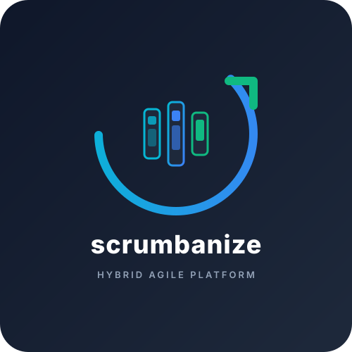

# Scrumbanize



Selbstgehostete Web-App, die Notizen und ein Scrumban-Board verbindet. Hintergrund und Ziele: [docs/vision.md](docs/vision.md), User Stories: [docs/stories](docs/stories).

**Stand:** US-01 bis US-07 sind umgesetzt:

- **Projekte:** Notizen und Board sind nach Projekten getrennt (z. B. „Privat“, „Studium“). Projekte werden im Header gewechselt, angelegt, umbenannt, eingefärbt und gelöscht (Bestätigung durch Eintippen des Namens; das letzte Projekt bleibt erhalten). Beim ersten Start gibt es das Projekt „Allgemein“; das zuletzt geöffnete Projekt merkt sich der Browser.
- **Notizen** (`/p/:projectId/notes`): Titel, Markdown-Inhalt und Tags, Auto-Save, Live-Suche und Tag-Filter.
- **Task-Umwandlung:** ganze Notizen oder markierte Textpassagen über ein vorausgefülltes Formular in Tasks in der ersten Spalte desselben Projekts umwandeln; Notiz und Task sind gegenseitig verlinkt.
- **Scrumban-Board** (`/p/:projectId/board`, Task-Details unter `/p/:projectId/tasks/:id`):
  - Eigene Spalten und Swimlanes pro Projekt: anlegen, per Doppelklick umbenennen, über das ⋯-Menü sortieren (Spalten auch per Drag-and-Drop am Kopf) und löschen. Tasks einer gelöschten Spalte oder Swimlane werden in eine wählbare andere verschoben. Höchstens 20 Spalten und 20 Swimlanes; Namen sind pro Projekt eindeutig.
  - Neue Projekte starten mit Backlog, To Do, In Progress (WIP-Limit 3), Review, Done und der Swimlane „Standard“. Swimlane-Köpfe erscheinen ab zwei Swimlanes und lassen sich einklappen (merkt sich der Browser).
  - WIP-Limits für jede Spalte, über alle Swimlanes gezählt – nur als Warnung, nicht blockierend.
  - Tasks per Drag-and-Drop zwischen Spalten und Swimlanes verschieben (Maus, Touch, Tastatur: Leertaste aufnehmen, Pfeiltasten, Leertaste ablegen) oder per ◀ ▶. Neue Tasks landen in der ersten Spalte; jede Swimlane hat dort ein eigenes „+ Task“.
  - „Kompakt“ verkleinert Karten und Spalten; Spaltenköpfe bleiben beim Scrollen sichtbar.
  - Task-Karten zeigen die Tags ihrer Notiz.
- **Aktivität** (`/p/:projectId/activity`): protokolliert automatisch, was im Projekt passiert – Notizen, Tasks (inkl. Umwandlung aus Notizen und Spalten-/Swimlane-Wechsel), Spalten, Swimlanes, WIP-Limits und Projekt-Änderungen. Chronologisch nach Tagen gruppiert, filterbar nach Bereich, lädt beim Scrollen nach; Einträge verlinken auf die Notiz bzw. den Task, solange es sie gibt. Bearbeitungen derselben Notiz oder desselben Tasks innerhalb von 10 Minuten (Auto-Save) werden zu einem Eintrag zusammengefasst; Umsortieren innerhalb einer Spalte wird nicht protokolliert.
- **Befehlspalette** (`Strg+K` / `⌘K`, oder „Suchen …“ im Header): durchsucht Notizen und Tasks aller Projekte (das aktuelle zuerst), wechselt Projekte und Ansichten, legt Notizen, Tasks und Projekte an und schaltet Farbschema und Kompaktansicht um.
- **Design:** helles und dunkles Farbschema (Hell / Dunkel / System, Standard: System; merkt sich der Browser), Schrift Inter (lokal eingebunden, kein externes CDN), dezente Animationen (respektieren „Bewegung reduzieren“) und Toast-Meldungen. Optimiert für Bildschirme ab 1024 px Breite.

Die App ist für einen einzelnen Nutzer ohne Login gedacht – betreibe sie nur in einem vertrauenswürdigen Netz oder hinter einem Reverse-Proxy mit Authentifizierung.

## Betrieb mit Docker

```sh
docker compose up -d --build
```

Die App läuft danach auf <http://localhost:3000>. Ein anderer Port lässt sich mit `SCRUMBANIZE_PORT=8080 docker compose up -d` setzen.

Die SQLite-Datenbank liegt im Volume `scrumbanize-data` (im Container unter `/data/scrumbanize.db`) und bleibt bei Neustarts und Updates erhalten. Backup, während der Container läuft:

```sh
docker compose exec scrumbanize node -e "require('better-sqlite3')('/data/scrumbanize.db').backup('/data/backup.db')"
docker compose cp scrumbanize:/data/backup.db ./backup.db
```

## Entwicklung

Voraussetzung: Node.js 24.

```sh
npm install
npm run dev        # API auf :3000, Vite-Dev-Server auf http://localhost:5173
npm test           # Tests für Server und Client
npm run typecheck
npm run build      # Client nach client/dist, Server nach server/dist
npm start          # Produktionsserver, liefert auch den gebauten Client aus
```

Lokal liegt die Datenbank unter `data/scrumbanize.db` (per `.gitignore` ausgeschlossen).

### Konfiguration (Umgebungsvariablen)

| Variable      | Standard                 | Bedeutung                               |
|---------------|--------------------------|-----------------------------------------|
| `PORT`        | `3000`                   | Port des Servers                        |
| `DATA_DIR`    | `<repo>/data`, Docker: `/data` | Verzeichnis der SQLite-Datenbank   |
| `CLIENT_DIST` | `<repo>/client/dist`     | Gebauter Client, der mit ausgeliefert wird |

## Projektstruktur

npm-Workspaces mit zwei Paketen:

- `server/` – Express-REST-API mit SQLite (`better-sqlite3`). Einstieg `src/index.ts`, App-Aufbau `src/app.ts`, Schema und Migrationen `src/database.ts`.
- `client/` – React-SPA mit TypeScript, Vite und Tailwind CSS. Farben kommen aus semantischen Design-Tokens (`bg-surface`, `text-fg-muted`, `border-line`, `bg-accent` …), definiert in `src/index.css` für hell und dunkel; wiederverwendbare Bausteine liegen in `src/components/ui/`.

## REST-API

| Methode | Pfad              | Beschreibung |
|---------|-------------------|--------------|
Listen und Neuanlagen gehören zu einem Projekt (`/api/projects/:projectId/…`). Einzelne Notizen und Tasks werden über ihre projektübergreifend eindeutige ID angesprochen.

| Methode | Pfad              | Beschreibung |
|---------|-------------------|--------------|
| GET     | `/api/health`     | Health-Check |
| GET     | `/api/projects`   | Alle Projekte, alphabetisch, mit `noteCount` und `taskCount` |
| POST    | `/api/projects`   | Projekt anlegen: `{ "name", "color" }` – Farben: `slate`, `red`, `amber`, `emerald`, `sky`, `indigo`, `violet`, `pink`. Namen sind eindeutig (ohne Groß-/Kleinschreibung), sonst 409 |
| PATCH   | `/api/projects/:id` | Name und/oder Farbe ändern |
| DELETE  | `/api/projects/:id` | Projekt mit allen Notizen und Tasks löschen; das letzte Projekt nicht (409) |
| GET     | `/api/projects/:id/notes` | Notizen des Projekts, zuletzt geänderte zuerst. Optional `?q=` (Volltext in Titel, Inhalt, Tags) und `?tag=` (mehrfach möglich, alle müssen passen) |
| POST    | `/api/projects/:id/notes` | Notiz anlegen: `{ "title": "", "content": "", "tags": [] }` |
| GET     | `/api/projects/:id/tags` | Tags der Notizen des Projekts mit Anzahl |
| POST    | `/api/projects/:id/tasks` | Task am Ende der ersten Spalte anlegen: `{ "title", "description", "sourceNoteId"?, "laneId"? }` – Notiz und Swimlane müssen zum Projekt gehören; ohne `laneId` die erste Swimlane |
| GET     | `/api/projects/:id/board` | Board des Projekts: `{ "columns": [{ id, name, position, wipLimit }], "lanes": [{ id, name, position }], "tasks" }` |
| POST    | `/api/projects/:id/columns` | Spalte anhängen: `{ "name", "wipLimit"? }` – Namen pro Projekt eindeutig (ohne Groß-/Kleinschreibung), max. 40 Zeichen; höchstens 20 Spalten (sonst 409) |
| POST    | `/api/projects/:id/lanes` | Swimlane anhängen: `{ "name" }` – gleiche Regeln wie bei Spalten |
| PATCH   | `/api/columns/:id` | Name und/oder WIP-Limit ändern: `{ "name"?, "wipLimit"?: number \| null }` |
| POST    | `/api/columns/:id/move` | Spalte umsortieren: `{ "index" }` – Position unter den übrigen Spalten |
| DELETE  | `/api/columns/:id?moveTasksTo=:columnId` | Spalte löschen; hat sie Tasks, ist `moveTasksTo` Pflicht (sonst 409). Die letzte Spalte bleibt erhalten (409) |
| PATCH, POST, DELETE | `/api/lanes/:id`, `/api/lanes/:id/move` | Swimlane umbenennen (`{ "name" }`), umsortieren und löschen – wie bei Spalten |
| GET     | `/api/notes/:id`  | Eine Notiz |
| PUT     | `/api/notes/:id`  | Notiz vollständig ersetzen: `{ "title", "content", "tags" }` |
| DELETE  | `/api/notes/:id`  | Notiz löschen |
| GET     | `/api/tasks/:id`  | Ein Task inkl. Quell-Notiz (`sourceNote`) |
| PATCH   | `/api/tasks/:id`  | Titel und/oder Beschreibung ändern: `{ "title"?, "description"? }` |
| POST    | `/api/tasks/:id/move` | Task verschieben: `{ "columnId", "laneId", "index" }` – Spalte und Swimlane müssen zum Projekt des Tasks gehören; `index` ist die Zielposition unter den übrigen Tasks der Zelle |
| DELETE  | `/api/tasks/:id`  | Task löschen |
| GET     | `/api/projects/:id/activities?type=&before=&limit=` | Aktivitätsprotokoll, neueste zuerst: `{ "items": [{ id, entityType, entityId, actionType, description, metadata, createdAt, exists }], "nextCursor" }`. `type`: `note`, `task`, `board` oder `project`; `before`: `nextCursor` der vorigen Seite; `limit` 1–100 (Standard 30). `exists` sagt, ob die Notiz bzw. der Task noch existiert |
| GET     | `/api/search?q=&project=&limit=` | Suche über alle Projekte für die Befehlspalette: `{ "notes": [{ id, projectId, title, snippet }], "tasks": [{ id, projectId, title, columnName }] }` – Treffer des Projekts `project` zuerst, `limit` 1–50 (Standard 20) |

Tags werden normalisiert (Kleinschreibung, ohne Kommas, max. 32 Zeichen). Tags, die keine Notiz mehr verwendet, werden automatisch entfernt. Notizen enthalten ihre verknüpften Tasks (`tasks`). Tasks sind Kopien: spätere Änderungen an der Notiz werden nicht übernommen, und beim Löschen einer Notiz bleiben ihre Tasks erhalten. Fehler haben die Form `{ "error": { "code", "message" } }`.
