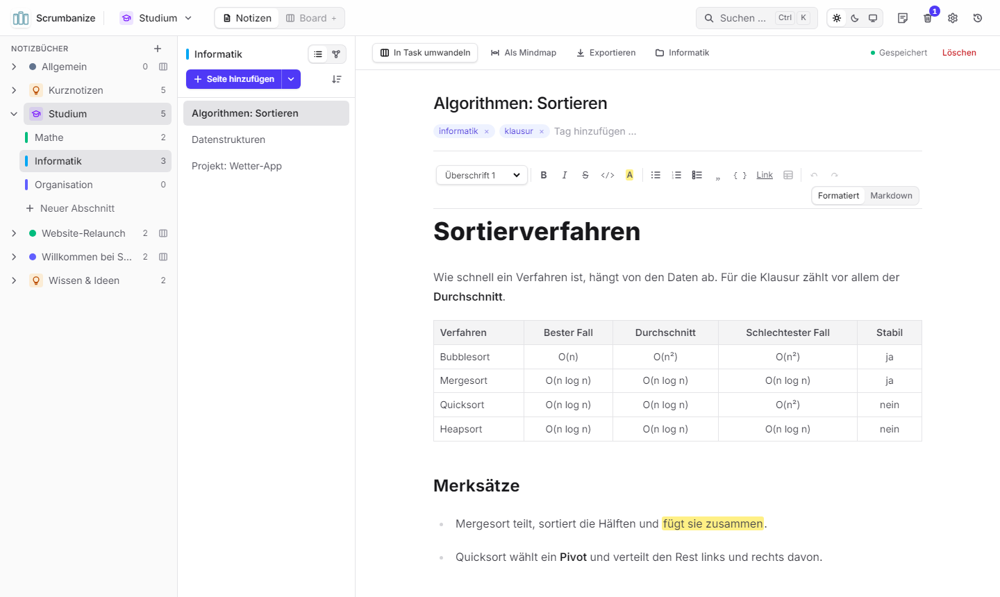
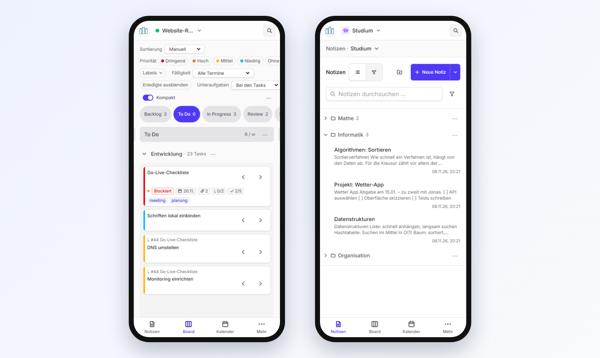
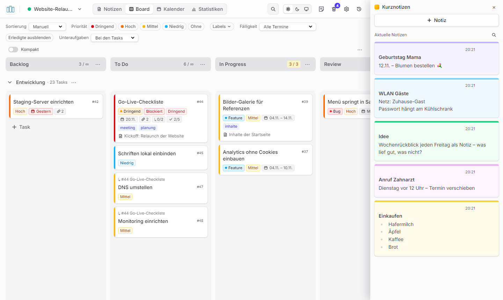
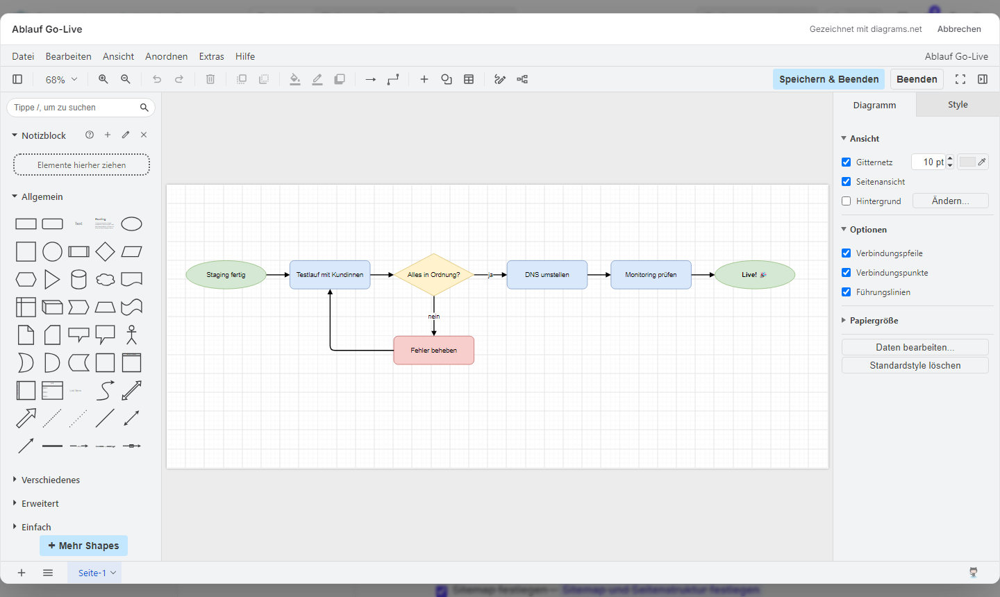
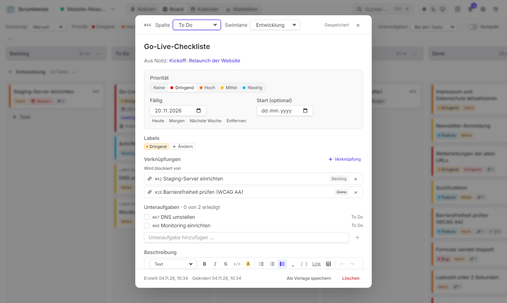
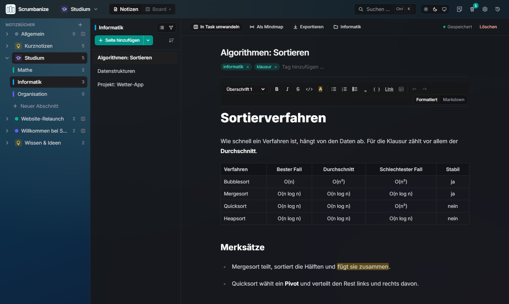

# Scrumbanize 1.2.0

## Überblick

Scrumbanize gibt es jetzt **auch im Browser**: unter **[scrumbanize.onrender.com](https://scrumbanize.onrender.com)**, mit eigenem Konto, auf dem Computer, Tablet und Handy. Die Desktop-App kann **mit der Web-Version verbunden** werden, dann sehen beide denselben Stand, und mehrere Personen arbeiten **live zusammen**.

Die Notizen sind jetzt in **Notizbüchern wie bei OneNote** organisiert, mit Abschnitten, Seiten und Verlinkungen. Neu sind außerdem **Tabellen**, **Kurznotizen** wie die Windows Sticky Notes, **Diagramme** mit diagrams.net, **Unteraufgaben**, ein **Kalender-Abo** für Outlook, Google und Apple sowie **Farbthemen und Hintergründe**.

Deine Daten bleiben beim Update erhalten. Die Datenbank wird beim ersten Start automatisch auf den neuen Stand gebracht.

## Neue Features und Highlights

### Web-Version mit Konten

- **Im Browser:** [scrumbanize.onrender.com](https://scrumbanize.onrender.com) – nichts zu installieren. Ein Konto gibt es per Einladung.
- **Anmeldung und Konten:** Anmelden mit E-Mail und Passwort, eigenes Profil mit Bild, Passwort ändern und zurücksetzen. Administratorinnen laden neue Personen per Link ein und verwalten die Konten.
- **Teilen mit Rollen:** Jedes Notizbuch und Projekt lässt sich mit anderen teilen: als *Besitzer*, *Mitglied* (bearbeiten) oder *Betrachter* (nur lesen).
- **Tägliche Backups auf dem Server** und vor jedem Update eine Sicherung der Datenbank.
- **Eigener Server:** Wer Scrumbanize selbst betreiben will, findet in [docs/DEPLOYMENT.md](https://github.com/lukxstim/Scrumbanize/blob/main/docs/DEPLOYMENT.md) eine Anleitung mit Docker und HTTPS.

### Desktop-App und Web-Version mit demselben Stand

- Unter **Einstellungen → Desktop-App → Speicherort** trägst du die Adresse der Web-Version ein und klickst „Verbinden“. Die Desktop-App zeigt dann die Daten des Servers, und du meldest dich einmal an.
- Ab dann sind **Desktop-App, Browser und Handy auf demselben Stand**. Erinnerungen, Kurznotizen und das Symbol neben der Uhr funktionieren weiter.
- Die Einstellungen zeigen, wo die Daten liegen. Mit **„Wieder auf diesem Computer speichern“** geht es zurück zu den lokalen Daten, ebenso über das Menü des Symbols neben der Uhr.
- Ist der Server beim Start nicht erreichbar, fragt die App, ob sie es noch einmal versuchen oder vorerst mit den Daten auf dem Computer arbeiten soll.

### Live zusammenarbeiten

- **Änderungen erscheinen sofort** bei allen, die dasselbe Board oder Notizbuch offen haben – ohne Neuladen.
- **Wer ist gerade da?** Kleine Avatare zeigen, wer ein Notizbuch, eine Seite oder eine Aufgabe gerade geöffnet hat.
- **Keine überschriebenen Texte:** Schreibt jemand anderes gerade an einer Notiz, siehst du das und kannst übernehmen. Gab es gleichzeitig Änderungen, wählst du, welche Fassung bleibt.

### Auf dem Handy und als App installierbar

- Die Web-Version passt sich an **Handy und Tablet** an: Navigation unten, große Touch-Flächen, Board spaltenweise zum Wischen, Karten per Finger verschieben.
- **Als App installieren:** Im Browser „Zum Startbildschirm hinzufügen“ (Handy) bzw. das Installieren-Symbol in der Adressleiste (Chrome, Edge). Neue Versionen meldet die App von selbst.

### Notizbücher wie bei OneNote

- **Alles in Notizbüchern:** Fürs Studium, ein Projekt, Rezepte oder Ideen – jedes mit Farbe und Symbol. Ein Notizbuch kann ein **Board** haben (mit Kalender und Statistiken) oder nur Notizen; das lässt sich jederzeit umschalten, Aufgaben gehen dabei nicht verloren.
- **Drei Spalten:** links die Notizbücher mit ihren **Abschnitten**, daneben die **Seiten**, rechts die Seite. Mehrere Notizbücher können gleichzeitig aufgeklappt sein.
- **Ordnen per Drag-and-Drop:** Seiten und Abschnitte in eine eigene Reihenfolge ziehen, Seiten in einen anderen Abschnitt oder ein anderes Notizbuch.
- **Verlinken:** `[[` tippen und eine Notiz oder Aufgabe auswählen – auch aus anderen Notizbüchern. Oder eine Seite aus der Liste **direkt in den Text ziehen**, dann entsteht dort ein Link.
- **„Verlinkt von“** unter jeder Notiz zeigt, was auf sie verweist; in den Einstellungen wählst du, ob der Bereich aufgeklappt startet.
- **Tags auf Wunsch:** Standardmäßig aufgeräumt; eingeschaltet gibt es einen Filter mit allen Tags.
- Wer lieber die bisherige **Listen-Ansicht** mit Textanfang und Datum mag, wählt sie in den Einstellungen.

### Tabellen im Editor

- „Tabelle einfügen“ in der Werkzeugleiste. Darin gibt es eine eigene Leiste: Zeilen und Spalten einfügen und löschen, Spalten ausrichten.
- `Tab` springt zur nächsten Zelle, `Enter` in die Zelle darunter.

### Kurznotizen wie die Windows Sticky Notes

- Für schnelle Kleinigkeiten: Knopf oben rechts, „+ Notiz“, tippen – fertig. Jede Kurznotiz ist eine **farbige Karte**, alles speichert sich selbst.
- In der **Desktop-App** ist die Leiste rechts am Bildschirmrand angedockt und bleibt vor allen Fenstern; unter Windows halten andere Fenster Platz für sie frei. In Chrome und Edge öffnet sie sich als kleines Fenster, das vorne bleibt.

### Diagramme mit diagrams.net

- **„+ Diagramm“** bei den Anhängen einer Notiz oder Aufgabe öffnet den Editor von diagrams.net (draw.io): Ablaufpläne, Mindmaps, Organigramme und mehr.
- **„Speichern & Beenden“** legt das Diagramm als Anhang ab – als Bild, das du mit dem Stift jederzeit wieder bearbeiten kannst.
- Der Diagramm-Editor braucht eine Internetverbindung.

### Kalender abonnieren

- **Einstellungen → Kalender abonnieren** erstellt einen persönlichen Link. In **Outlook, Google Kalender oder Apple Kalender** eingetragen, erscheinen deine Aufgaben mit Start- oder Fälligkeitsdatum dort als ganztägige Termine – und aktualisieren sich von selbst.
- Der Link ist geheim und wird nur einmal angezeigt; er lässt sich jederzeit neu erstellen oder widerrufen.

### Aufgaben

- **Unteraufgaben:** Eine Aufgabe kann Unteraufgaben haben, mit Fortschritt („1 von 3 erledigt“) auf der Karte. Auf dem Board stehen sie bei ihrer Aufgabe oder in eigenen Zeilen.
- **Start und Fälligkeit beim Umwandeln:** Wird eine Notiz zur Aufgabe, lassen sich gleich Start- und Fälligkeitsdatum setzen; „+“ im Kalender legt Aufgaben mit Startdatum an.
- **„Erledigte ausblenden“** auf dem Board.
- Auf dem Board erscheinen verlinkte Notizen als Zähler mit Notiz-Symbol.

### Farbthemen und Hintergründe

- Unter **Einstellungen → Darstellung**: acht Farbthemen (Indigo, Blau, Türkis, Grün, Bernstein, Rose, Violett, Graphit) und Hintergründe wie *Morgenrot*, *Ozean* oder *Wald* – oder ein eigenes Bild. Zusammen mit Hell und Dunkel.

## UI/UX- und Performance-Verbesserungen

- **Kopfzeile:** Die Reiter behalten ihre Namen, solange Platz ist; „Zurück“ aus den Einstellungen (auch mit `Esc`) führt dorthin, wo du warst.
- **Schneller:** Die erste Notiz öffnet spürbar schneller, weil der Editor im Hintergrund vorbereitet wird.
- **Kein Verrutschen mehr:** Die Seite scrollt nicht mehr ungewollt mit, z. B. am Ende langer Notizen.
- **Board für kleine Fenster:** Die Leiste über dem Board bricht sauber um, Karten und Spalten passen sich an.
- Die Suche (`Strg` + `K`) durchsucht alle Notizbücher gleichzeitig, auch die Kurznotizen.

## Hinter den Kulissen

- Die Release-Notizen auf GitHub kommen jetzt direkt aus dieser Datei.
- Neue Tests für Konten, Rechte, Live-Updates, Kalender-Abo, Diagramme und die Verbindung der Desktop-App – insgesamt über 700.

## Installation und Systemanforderungen

| | Windows | Mac | Browser |
|---|---|---|---|
| **System** | Windows 10 oder 11, 64 Bit | macOS 12 (Monterey) oder neuer, Apple-Chip oder Intel | aktuelles Chrome, Edge, Firefox oder Safari – auch auf Handy und Tablet |
| **Datei** | `Scrumbanize-Setup-1.2.0.exe` (Installer) oder `Scrumbanize-1.2.0-portable.exe` | `Scrumbanize-1.2.0-universal.dmg` (alternativ `.zip`) | – |
| **Installieren** | Datei ausführen – ohne Administrator-Passwort | `.dmg` öffnen und Scrumbanize auf den Ordner „Programme“ ziehen | [scrumbanize.onrender.com](https://scrumbanize.onrender.com) öffnen und anmelden |
| **Daten** | `%APPDATA%\Scrumbanize` | `~/Library/Application Support/Scrumbanize` | auf dem Server |

**Update von 1.1.0:** Unter Windows einfach den neuen Installer ausführen, auf dem Mac die App im Ordner „Programme“ ersetzen. Notizen, Aufgaben und Einstellungen bleiben erhalten.

**Notizen der Desktop-App in die Web-Version übernehmen:** in der Desktop-App unter Einstellungen „Backup herunterladen“, dann in der Web-Version (als Administratorin bzw. Administrator) unter Einstellungen „Wiederherstellen“. Danach die Desktop-App unter „Speicherort“ verbinden.

**Windows-SmartScreen:** Beim ersten Start kann „Der Computer wurde durch Windows geschützt“ erscheinen. Auf **„Weitere Informationen“** und dann **„Trotzdem ausführen“** klicken.

**Hinweis für den Mac (Gatekeeper):** Scrumbanize ist kostenlos und nicht bei Apple registriert. Der Mac fragt deshalb beim ersten Start einmal nach:

- **macOS 15 (Sequoia) und neuer:** Scrumbanize öffnen, die Meldung mit „Fertig“ schließen, dann Apple-Menü → **Systemeinstellungen** → **Datenschutz & Sicherheit** → ganz unten **„Dennoch öffnen“** klicken und mit dem Mac-Passwort bestätigen.
- **macOS 14 (Sonoma) und älter:** Scrumbanize im Ordner „Programme“ mit gedrückter `ctrl`-Taste anklicken (oder Rechtsklick), **„Öffnen“** wählen und noch einmal **„Öffnen“** bestätigen.

Die ausführliche Schritt-für-Schritt-Anleitung steht in der [README](https://github.com/lukxstim/Scrumbanize#anleitung-für-die-installation).
